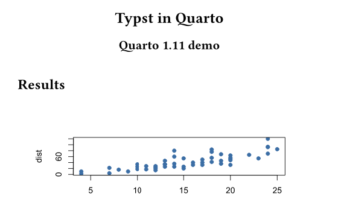
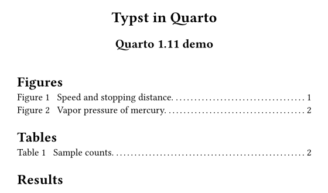
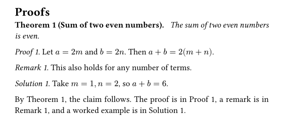

# Quarto 1.11 Has Been Released: Comparing the New Typst Features Visually

quarto

typst

A visual before-and-after look at the new Typst features in Quarto 1.11 (lists of figures and tables, framed proof blocks, cross-references), plus a short summary of the other changes.

Published

2026-11-07

Modified

2026-11-07

[日本語版](../../../posts/2026-11-07-quarto-1.11/)

On November 2, 2026, the [official announcement post](https://opensource.posit.co/blog/2026-11-02_quarto-1-11/) for Quarto 1.11 was published. This release came out early to deliver a security update for Deno, the runtime Quarto uses for things like HTTPS requests. It also includes improvements to accessibility, Typst, Julia, and shared metadata. The full list of changes is in the [release notes](https://quarto.org/docs/download/changelog/1.11/).

This article focuses on the new features for Typst output, which produces PDFs, and **renders the same document with 1.10 and 1.11 so you can compare the results**. The other changes are summarized briefly at the end.

## The Document Used for Comparison

I prepared a short test document with two figures, one table, and theorem and proof blocks. The source is in the [GitHub repository](https://github.com/maple60/maple60.github.io/blob/main/posts/2026-11-07-quarto-1.11/_typst-demo/demo.qmd). The YAML header is shown below. `lof` and `lot` are new in 1.11 and are explained later.

``` yaml
format:
  typst:
    papersize: a5
lof: true
lot: true
crossref:
  lof-title: "Figures"
  lot-title: "Tables"
```

The images below are the result of running `quarto render` on the same file with Quarto 1.10.18 and 1.11.9 and compiling it with Typst.

## Lists of Figures and Tables (`lof` and `lot`)

Quarto 1.11 can generate a list of figures and a list of tables in Typst output. Just add `lof: true` and `lot: true` to the YAML. The headings follow the document language. To change them, set `lof-title` and `lot-title` under `crossref`.

On the left is the top of page 1 from 1.10.18, and on the right is the same part from 1.11.9. In 1.11, a list of figures and a list of tables with page numbers is inserted below the title.



Quarto 1.10.18



Quarto 1.11.9

## Proof, Remark, and Solution Blocks with Cross-References

According to the official announcement, Quarto 1.11 renders proof, remark, and solution blocks with the same machinery as theorems. As a result, **labeled blocks can be cross-referenced**. The ID prefixes are `prf-` for proofs, `rem-` for remarks, and `sol-` for solutions.

``` markdown
::: {#prf-sum .proof}
Let $a = 2m$ and $b = 2n$. Then $a + b = 2(m + n)$.
:::

The proof is in @prf-sum.
```

The image below is the actual output from 1.11.9. Labeled blocks are numbered like “Proof 1.”, and `@prf-sum` in the text is replaced with “Proof 1”.



Proofs section rendered by Quarto 1.11.9

> **NOTE:**
>
> In this test, I did not see proof blocks and similar blocks gain a visible box. The visible changes are numbering and cross-references. An unlabeled `.proof` is still output as an unnumbered “Proof.”, and I saw no difference from 1.10.18. The 1.10.18 image comes from the same document before I added the labels, and I did not render labeled blocks with 1.10.18 for comparison. The description of 1.10 behavior is based on the official announcement.

## Font Names in Typst

CSS generic font family names (`serif`, `sans-serif`, and `monospace`) are now resolved to available fonts. Previously these names were passed to Typst as they were, which caused warnings. This does not change the appearance, so I skip the image comparison.

The bundled Typst version is 0.15.1, the same as in 1.10.

## Other Changes

Here is a brief summary of the main non-Typst changes described in the official post. See the post and the release notes for details.

- **Security update**: The bundled Deno is now 2.9.8, which rejects certificate chains containing the compromised eMudhra and emSign keys. It is not backported to 1.10, and 1.10.20 is the final patch release of that series. The updated Deno requires macOS 12 or later.
- **Accessibility**: Improvements include a “Skip to main content” link, keyboard operation, focus rings, and named navigation regions. Alt text (`fig-alt`) for Mermaid and Graphviz diagrams is now preserved in HTML, Revealjs, Word, and Typst.
- **Julia**: `execute-dir` and `keep-ipynb: true` are supported, and hanging issues were fixed.
- **New definition list syntax**: You can write a `.definition-list` div containing nested bullet lists. The post says this is the syntax used by Quarto 2.
- **Metadata merging**: How shared metadata (project-level and similar) is combined with same-named document keys was fixed. If you use keys such as `keywords` to override inherited values, check the result.
- **Stricter website metadata validation**: Misspelled `open-graph` and `twitter-card` options now fail the render instead of being ignored. For a site with many pages like this one, it is worth rendering everything once after updating.
- **Custom SCSS for themes**: Focus ring variables are now `$focus-ring-outer-color` and similar. Bootstrap’s `$focus-ring-color` and related variables are no longer used for this.

## How to Update

The update procedure is in my [Quarto 1.9 article](../../posts/2026-03-25-quarto-1.9/index.llms.md). After updating, run `quarto --version` to confirm that you are on 1.11.

## Sources and Rights

This article is my own summary based on the official announcement post and the release notes. I did not copy official text or images. The images shown here were produced by rendering my own test document with Quarto. Quarto is a registered trademark of [Posit](https://posit.co/). This article is not an official Quarto page and is not affiliated with or endorsed by Posit.
