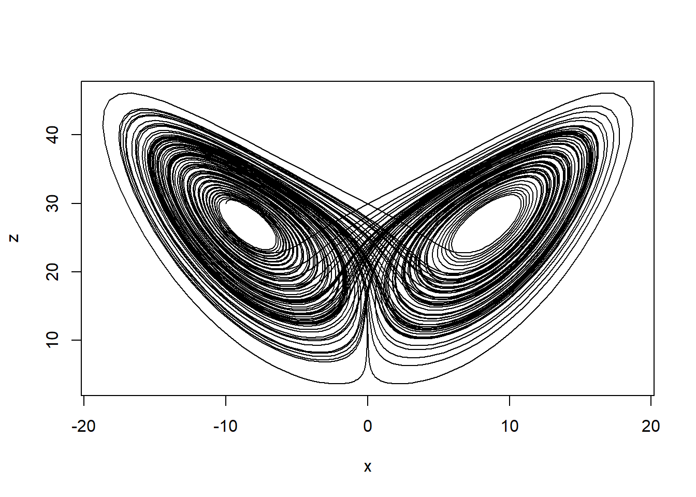
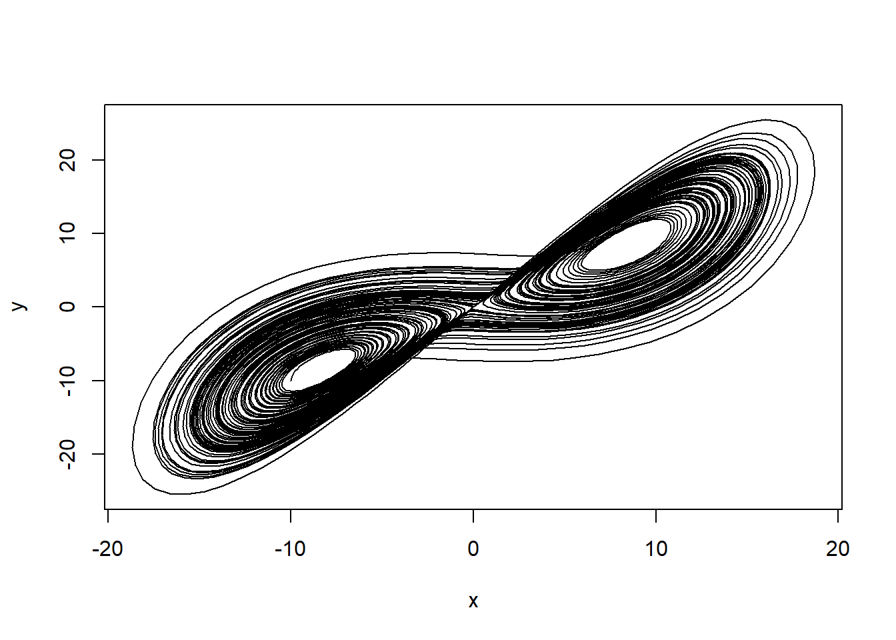
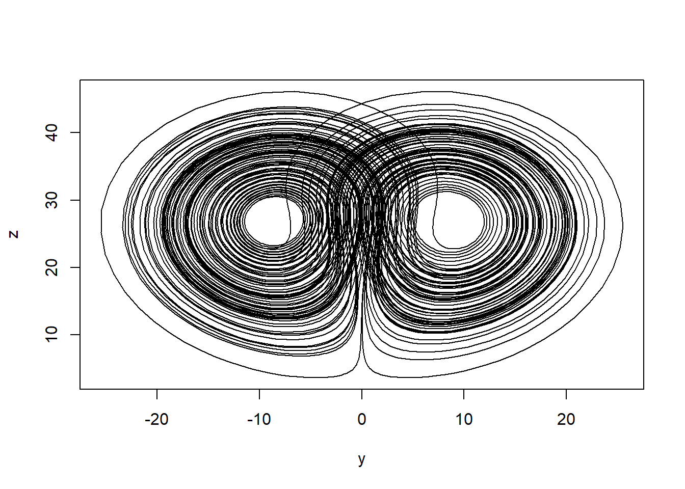
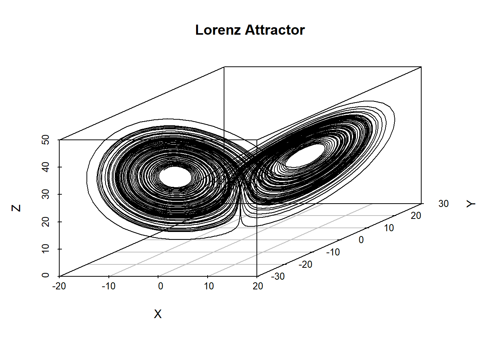
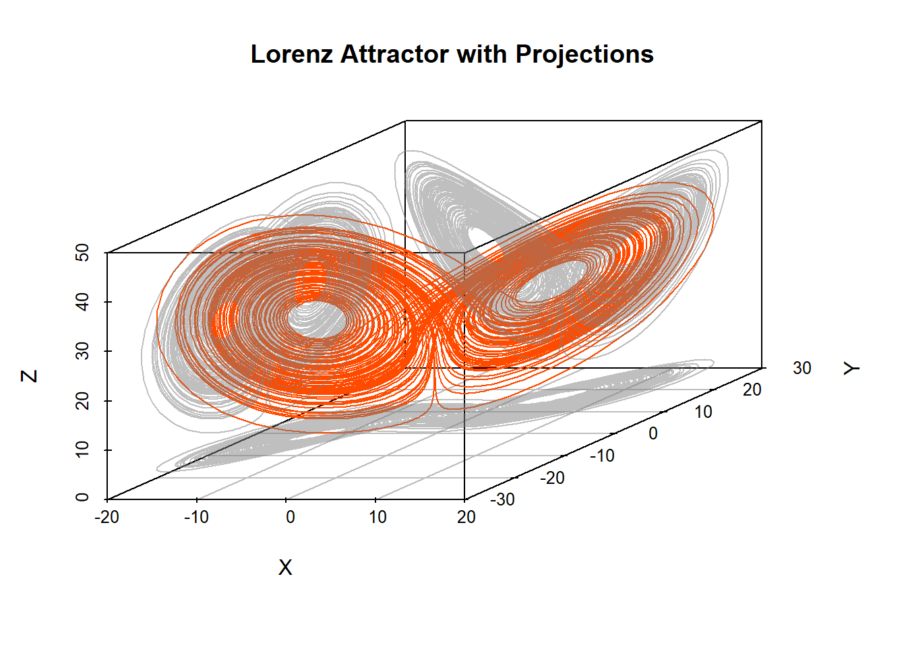

# RでLorenz attractorを描く

r

deSolveパッケージを使ってLorenz方程式を解き、Lorenz attractorを描画する方法を紹介します。また、scatterplot3dやplotlyパッケージを使用して3Dプロットを作成する方法も示します

公開

2026-02-02

更新日

2026-02-02

[English version](../../en/posts/2026-02-02-r-lorenz-attractor/)

Lorenz attractorは、[Edward Lorenz](https://www.lorenz.mit.edu/edward-n-lorenz)氏によって報告されたカオス理論の一例であり、非線形力学系の挙動を示す有名なモデルです。

以下に、Rの[deSolve](https://cran.r-project.org/web/packages/deSolve/index.html)パッケージを使用してLorenz attractorを描く方法を示します。

> **NOTE:**
>
> Lorenz attractorとLorenz方程式の違いは以下です。\
> - **Lorenz方程式**: 非線形常微分方程式のセットであり、特定のパラメータ値に基づいてシステムの時間発展を記述します。\
> - **Lorenz attractor**: その長時間挙動として現れる集合であり、Lorenz方程式の解が時間とともに収束する特定のパターンを示します。

## Lorenz方程式の定義

Lorenz方程式は以下の3つの常微分方程式から構成されます。

\\ \begin{align} \frac{dx}{dt} &= \sigma (y - x) \\ \frac{dy}{dt} &= x(\rho - z) - y \\ \frac{dz}{dt} &= xy - \beta z \end{align} \\

ここで、\\x\\、\\y\\、および\\z\\はシステムの状態変数であり、\\\sigma\\、\\\rho\\、および\\\beta\\はパラメータです。一般的に使用されるパラメータ値は以下の通りです。

- \\\sigma = 10\\
- \\\rho = 28\\
- \\\beta = \frac{8}{3}\\

## deSolveパッケージのインストールと読み込み

まず、[deSolve](https://cran.r-project.org/web/packages/deSolve/index.html)パッケージをインストールし、読み込みます。

``` downlit
install.packages("deSolve")  # if it is not installed yet
library(deSolve)
```

[renv](https://rstudio.github.io/renv/articles/renv.html)パッケージを使用している場合は、以下のようにします。

``` downlit
renv::install("deSolve") # if it is not installed yet
```

``` downlit
library(deSolve)
```

    Warning: package 'deSolve' was built under R version 4.5.3

## Lorenz方程式の実装

まずは、Lorenz方程式をRの関数として実装します。

``` downlit
lorenz <- function(t, state, parameters) {
  with(as.list(c(state, parameters)), {
    dx <- sigma * (y - x)
    dy <- x * (rho - z) - y
    dz <- x * y - beta * z
    list(c(dx, dy, dz))
  })
}
```

次に、初期状態、パラメータ、時間の範囲を設定します。

``` downlit
state <- c(x = -10, y = -10, z = 30)
parameters <- c(sigma = 10, rho = 28, beta = 8 / 3)
times <- seq(0, 100, by = 0.01)
```

[`ode()`](https://rdrr.io/pkg/deSolve/man/ode.html)関数を使用してLorenz方程式を解きます。

``` downlit
out <- ode(y = state, times = times, func = lorenz, parms = parameters)
out <- as.data.frame(out)
```

## Lorenz attractorの描画

まずは二次元のプロットを作成します。 x-y平面、x-z平面、y-z平面の3つのプロットを描きます。

``` downlit
plot(out$x, out$z, type = "l", xlab = "x", ylab = "z")
```



``` downlit
plot(out$x, out$y, type = "l", xlab = "x", ylab = "y")
```



``` downlit
plot(out$y, out$z, type = "l", xlab = "y", ylab = "z")
```



## 3Dプロットの作成

Rの[scatterplot3d](https://cran.r-project.org/web/packages/scatterplot3d/index.html)パッケージを使用して、3Dプロットを作成します。

まだインストールしていない場合は、以下のコマンドでインストールしてください。

``` downlit
install.packages("scatterplot3d")  # if it is not installed yet
renv::install("scatterplot3d") # when using renv
```

``` downlit
library(scatterplot3d)
scatterplot3d(
  out$x,
  out$y,
  out$z,
  type = "l",
  xlab = "X",
  ylab = "Y",
  zlab = "Z",
  main = "Lorenz Attractor"
)
```



また、それぞれの面に投影した2Dプロットも描いてみます。

``` downlit
s3d <- scatterplot3d(
  out$x,
  out$y,
  out$z,
  type = "n",
  xlab = "X",
  ylab = "Y",
  zlab = "Z",
  main = "Lorenz Attractor with Projections"
)
s3d$points3d(out$x, out$y, out$z, type = "l", col = "#FF4B00") # main Lorenz attractor
s3d$points3d(
  out$x,
  out$y,
  rep(min(out$z), nrow(out)),
  type = "l",
  col = adjustcolor("gray50", alpha.f = 0.5)
) # projection onto the x-y plane
s3d$points3d(
  out$x,
  rep(max(out$y), nrow(out)),
  out$z,
  type = "l",
  col = adjustcolor("gray50", alpha.f = 0.5)
) # projection onto the x-z plane
s3d$points3d(
  rep(min(out$x), nrow(out)),
  out$y,
  out$z,
  type = "l",
  col = adjustcolor("gray50", alpha.f = 0.5)
) # projection onto the y-z plane
```



## Plotlyを使ったインタラクティブな3Dプロット

Rの[plotly](https://cran.r-project.org/web/packages/plotly/index.html)パッケージを使用して、インタラクティブな3Dプロットを作成します。

まだインストールしていない場合は、以下のコマンドでインストールしてください。

``` downlit
install.packages("plotly")  # if it is not installed yet
renv::install("plotly") # when using renv
```

``` downlit
library(plotly)
```

    Warning: package 'plotly' was built under R version 4.5.3

    Loading required package: ggplot2

    Warning: package 'ggplot2' was built under R version 4.5.3

    Attaching package: 'plotly'

    The following object is masked from 'package:ggplot2':

        last_plot

    The following object is masked from 'package:stats':

        filter

    The following object is masked from 'package:graphics':

        layout

``` downlit
fig <- plot_ly(
  x = out$x,
  y = out$y,
  z = out$z,
  type = 'scatter3d',
  mode = 'lines'
)
fig <- fig %>%
  layout(
    title = "Lorenz Attractor",
    scene = list(
      xaxis = list(title = 'X'),
      yaxis = list(title = 'Y'),
      zaxis = list(title = 'Z')
    )
  )
fig
```

時間まで含めた色変化も可能です。

``` downlit
fig <- plot_ly(
  data = out,
  x = ~x,
  y = ~y,
  z = ~z,
  color = ~time,
  colors = colorRamp(c("blue", "red")),
  type = 'scatter3d',
  mode = 'lines'
)
fig
```

また、時間フレームによるアニメーションも追加できます。 描画フレームを間引いて軽量化しています。

``` downlit
idx <- seq(1, nrow(out), by = 10) # thin frames to reduce the number of frames
out2 <- out[idx, ]

fig <- plot_ly() %>%
  # Static trajectory line
  add_trace(
    data = out,
    x = ~x,
    y = ~y,
    z = ~z,
    type = "scatter3d",
    mode = "lines",
    line = list(color = "gray")
  ) %>%
  # Moving point
  add_trace(
    data = out2,
    x = ~x,
    y = ~y,
    z = ~z,
    frame = ~time,
    type = "scatter3d",
    mode = "markers",
    marker = list(size = 3, color = "#FF4B00")
  ) %>%
  animation_opts(
    frame = 50, # display time per frame in milliseconds
    transition = 0 # disable interpolation animation to make it lighter
  )

fig
```

## 参考になるページ

- [Lorenz system - Wikipedia](https://en.wikipedia.org/wiki/Lorenz_system)
- [CRAN: Package deSolve](https://cran.r-project.org/web/packages/deSolve/index.html)
- [Plotly r graphing library in R](https://plotly.com/r/)
