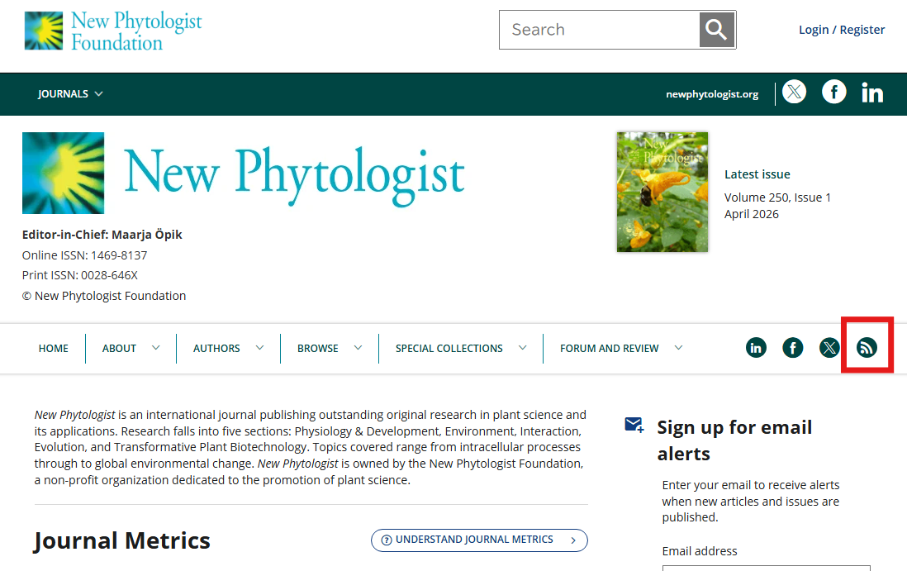
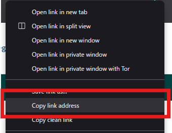
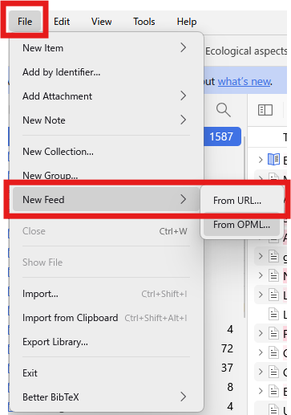
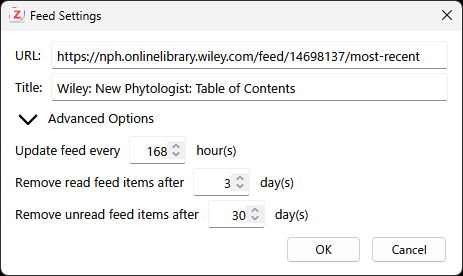
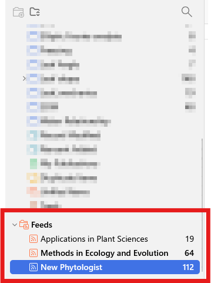
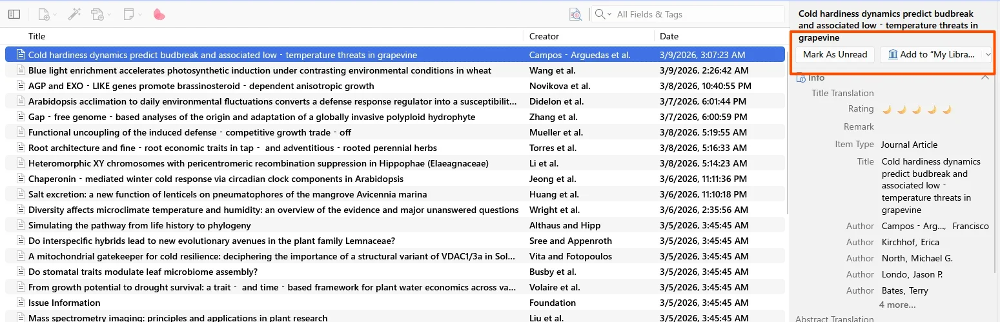
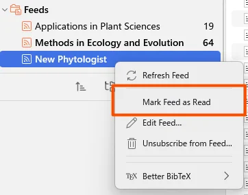

::::: {.content-visible unless-profile="en"}

## Zoteroとは

Zoteroは、文献管理ツールの一つで、論文や書籍などの情報を整理するために広く使用されています。

## RSSフィードとは

RSSフィードは、ウェブサイトの更新情報を配信するためのフォーマットで、ユーザーが特定のウェブサイトの更新情報を受け取ることができます。
今回の場合は、論文雑誌のRSSフィードを作成することで、新しい論文が公開されたときに通知を受け取ることができます。

## 方法

### ジャーナルのRSSフィードを見つける

多くのジャーナルは、ウェブサイト上でRSSフィードを提供しています。
例えば、[New Phytologist](https://nph.onlinelibrary.wiley.com/journal/14698137)のHPに行ってみます。

右側に、RSSフィードのアイコンがあるので、これを右クリックします。

右クリックメニュー(コンテキストメニュー)が表示されるため、「リンクのアドレスをコピー (Copy link address)」を選択します。

## ZoteroでRSSフィードを購読する

Zoteroを開き、[File] > [New Feed] > [From URL...]を選択します。

現れたダイアログのURLの欄に、先ほどコピーしたRSSフィードのURLを貼り付けます。
もしRSSフィードのURLが正しい場合は、Titleの欄にジャーナルの名前が自動的に入力されます。

Advanced Optionsの欄は、以下のようになっています。

- フィードの更新頻度 (デフォルトは168時間、つまり1週間)
- 既読のフィードのアイテムを削除する間隔 (デフォルトでは3日)
- 未読のフィードのアイテムを削除する間隔 (デフォルトでは30日)

私は以下のように設定を変更しました。

- Title: New Phytologist (ジャーナル名のみ)
- フィードの更新頻度: 24時間 (毎日更新を確認するように設定)

そのほかはデフォルトのままです。

設定が完了したら、[OK]をクリックします。

左側のサイドバーにFeedsという項目ができ、その中にNew Phytologistというフィードが追加されていれば成功です。

## フィードアイテムを確認する

Feedsの欄からフィードアイテムを確認したいジャーナルを選択します。
中央のペインにフィードアイテムのリストが表示されます。

カーソルを合わせるとRead(既読)になり、行のフォントが太字から通常のものに変わります。
アイテムをダブルクリックすると、ジャーナルのウェブサイトにアクセスできます。

右側のペインでは、書誌情報が確認できるほか、[Mark As Unread]や[Mark As Read]をクリックして、アイテムの既読/未読を切り替えることができます。
[Add to "My Library..."]をクリックすると、任意のライブラリにアイテムを追加することができます。

一気にジャーナルごとに既読にしたい場合は、Feedsの欄のジャーナル名を右クリックして、**[Mark Feed as Read]**を選択します。

## まとめ

Zoteroを使って、ジャーナルのRSSフィードを購読する方法についてまとめました。
私はこれまで、RSSリーダーを使ってジャーナルの更新情報を確認していましたが、Zoteroを使うことで、フィードアイテムを簡単にライブラリに追加したり、書誌情報を管理したりすることができるようになりました。

漏れている機能などありましたら、追記したいと思います。

:::::

::::: {.content-visible when-profile="en"}

## What Is Zotero?

Zotero is a reference management tool widely used for organizing information about papers, books, and other sources.

## What Is an RSS Feed?

An RSS feed is a format for distributing update information from websites.
It allows users to receive updates from specific websites.
In this case, by creating RSS feeds for academic journals, you can receive notifications when new papers are published.

## Method

### Find the Journal's RSS Feed

Many journals provide RSS feeds on their websites.
As an example, go to the homepage of [New Phytologist](https://nph.onlinelibrary.wiley.com/journal/14698137).

There is an RSS feed icon on the right side, so right-click it.

A right-click menu, or context menu, appears.
Select "Copy link address."

## Subscribe to the RSS Feed in Zotero

Open Zotero and select [File] > [New Feed] > [From URL...].

Paste the RSS feed URL copied earlier into the URL field of the dialog that appears.
If the RSS feed URL is correct, the journal name is automatically entered in the Title field.

The Advanced Options section contains the following settings.

- Feed update frequency; the default is 168 hours, or one week
- Interval for deleting read feed items; the default is 3 days
- Interval for deleting unread feed items; the default is 30 days

I changed the settings as follows.

- Title: New Phytologist, using only the journal name
- Feed update frequency: 24 hours, so updates are checked daily

I left the other settings at their defaults.

After completing the settings, click [OK].

If a Feeds section appears in the left sidebar and a feed named New Phytologist has been added inside it, the setup was successful.

## Check Feed Items

From the Feeds section, select the journal whose feed items you want to check.
A list of feed items appears in the center pane.

When you move the cursor over an item, it becomes Read, and the row font changes from bold to normal.
Double-clicking an item opens the journal website.

In the right pane, you can check bibliographic information.
You can also click [Mark As Unread] or [Mark As Read] to switch the item between unread and read.
Clicking [Add to "My Library..."] lets you add the item to any library.

If you want to mark all items in a journal feed as read at once, right-click the journal name in the Feeds section and select **[Mark Feed as Read]**.

## Summary

This article summarized how to subscribe to journal RSS feeds with Zotero.
Until now, I had used an RSS reader to check journal updates, but using Zotero makes it easy to add feed items to the library and manage bibliographic information.

If I notice any missing features, I will add them later.

:::::

