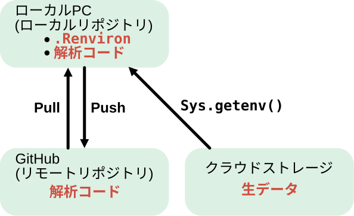

::::: {.content-visible unless-profile="en"}

解析の生データをクラウドストレージから読み込む方法を紹介します。

この記事では、以下のような管理方法を前提とします。

- 解析の生データ: クラウドストレージ（[Google Drive](https://workspace.google.com/products/drive/)、[OneDrive(https://www.microsoft.com/en-us/microsoft-365/onedrive/online-cloud-storage)]、[Dropbox](https://www.dropbox.com/)など）に保存  
- 解析コード: [GitHub](https://github.com/)などのソースコード管理サービスに保存

このように分けることで、データとコードを分離して管理できます。
また、生データを Git管理下に置かなくても、クラウドストレージを使ってバックアップや共有をしやすくなります。

ただし、この方法はクラウドストレージそのものに依存するのではなく、**R から通常のファイルパスとして参照できる場所にデータがあること**を前提としています。
たとえば Google Drive for desktop や OneDrive、Dropbox などを使えば、クラウド上のデータをローカルのファイルと同じように扱うことができます。

概念図を示すと、以下のようになります。



## `.Renviron`ファイルの作成

解析コードをGit管理しつつ、データの保存場所をローカル環境ごとに切り替えたい場合は、`.Renviron`ファイルに環境変数として保存先を定義しておくと便利です。

たとえば、以下のように設定します。

:::::

::::: {.content-visible when-profile="en"}

This article introduces a way to read raw analysis data from cloud storage.

It assumes the following management approach.

- Raw analysis data: stored in cloud storage such as [Google Drive](https://workspace.google.com/products/drive/), [OneDrive](https://www.microsoft.com/en-us/microsoft-365/onedrive/online-cloud-storage), or [Dropbox](https://www.dropbox.com/)
- Analysis code: stored in a source-code management service such as [GitHub](https://github.com/)

By separating these, data and code can be managed independently.
Also, even if raw data is not placed under Git management, cloud storage makes backup and sharing easier.

However, this method does not depend on cloud storage itself.
It assumes that **the data exists in a location that R can refer to as a normal file path**.
For example, by using Google Drive for desktop, OneDrive, or Dropbox, data in the cloud can be handled like local files.

The conceptual diagram is as follows.


## Creating a `.Renviron` File

If you want to manage analysis code with Git while switching the data storage location for each local environment, it is useful to define the storage location as an environment variable in a `.Renviron` file.

For example, set it as follows.

:::::

```{.text filename=".Renviron"}
PROJECT_DATA_DIR=C:/Users/Username/Dropbox/GitHub/repository-name
```

::::: {.content-visible unless-profile="en"}

## データの読み込み

`.Renviron`に環境変数を設定しておけば、Rでは`Sys.getenv()`を使ってその値を取得できます。

:::::

::::: {.content-visible when-profile="en"}

## Reading Data

If an environment variable is set in `.Renviron`, R can obtain its value with `Sys.getenv()`.

:::::

```{.r}
data_dir <- Sys.getenv("PROJECT_DATA_DIR")
```

::::: {.content-visible unless-profile="en"}

このようにして取得したパスを使えば、クラウドストレージ上にあるデータを、ディレクトリ構造を保ったまま読み込めます。

必要に応じて、設定が存在するか確認しておくと安全です。

:::::

::::: {.content-visible when-profile="en"}

Using the path obtained this way, data stored in cloud storage can be read while preserving the directory structure.

It is safer to check whether the setting exists when needed.

:::::

```{.r}
data_dir <- Sys.getenv("PROJECT_DATA_DIR")

if (identical(data_dir, "")) {
  stop("PROJECT_DATA_DIR is not set.")
}
```

::::: {.content-visible unless-profile="en"}

::: {.callout-warning}
`.Renviron` ファイルを新しく作成・編集した場合は、**Rセッションを再起動して反映**させてください。
:::

## `.Renviron`ファイル使う際の注意点

### 保存場所

`.Renviron` は、**このプロジェクト専用の設定として使うなら、プロジェクトのルートディレクトリに置く**とわかりやすいです。  
一方で、複数のプロジェクトで共通して使いたい設定は、ユーザー単位の `.Renviron` に書く方法もあります。

### パスの書き方

`.Renviron` には、**絶対パス**を書いておくのが安全です。

### Gitで管理しない

`.Renviron` は、通常は **Git 管理下に置かない**方がよいです。  
そのため、`.gitignore` に `.Renviron` を追加して、誤ってコミットしないようにしておきます。

:::::

::::: {.content-visible when-profile="en"}

::: {.callout-warning}
If you create or edit a `.Renviron` file, **restart the R session for the change to take effect**.
:::

## Notes When Using a `.Renviron` File

### Storage Location

If `.Renviron` is used as a setting specific to this project, placing it in the project root directory is easy to understand.
On the other hand, settings shared across multiple projects can also be written in a user-level `.Renviron`.

### Writing Paths

It is safer to write **absolute paths** in `.Renviron`.

### Do Not Manage It with Git

Normally, `.Renviron` should **not be placed under Git management**.
For that reason, add `.Renviron` to `.gitignore` to avoid committing it by mistake.

:::::

```{.text filename=".gitignore"}
.Renviron
```

::::: {.content-visible unless-profile="en"}

ただし、`.gitignore` は未追跡ファイルを無視するための設定です。  
すでに Git にコミット済みの `.Renviron` には、そのままでは効果がありません。  
誤って追跡してしまった場合は、別途 Git 側で追跡対象から外す必要があります。

### 共有方法

`.Renviron` は各自のローカル環境で作成することになるため、リポジトリには含めません。  
その代わり、`README.md` などに `.Renviron` の作成方法を記載しておくと、共同研究者や将来の自分が環境を再構築しやすくなります。

## まとめ

生データをクラウドストレージに置き、解析コードをGitHubで管理し、両者を`.Renviron`の環境変数でつなぐことで、データとコードを分離しつつ、再現性のある解析環境を作ることができます。

クラウドストレージ上のデータをRから通常のファイルパスとして参照できる環境であれば、この方法は比較的簡単に導入できます。

## なぜこの方法をまとめたか

余談ですが、この方法は、私が最近のプロジェクトで実際に採用している管理方法です。
経緯としては、Cドライブ直下にGitHubフォルダを作り、そこにデータをすべて入れていたのですが、ある日そのPCが起動しなくなってしまい、データを失いかけました。

そこで、データはクラウドストレージに置いておき、コードはGitHubで管理する方法に切り替えました。
バックアップの重要性を痛感した経験から、データとコードの管理方法を見直すことにしました。

:::::

::::: {.content-visible when-profile="en"}

However, `.gitignore` is a setting for ignoring untracked files.
It has no effect on a `.Renviron` file that has already been committed to Git.
If it has been tracked by mistake, it needs to be removed from Git tracking separately.

### Sharing the Setup

Because each person creates `.Renviron` in their own local environment, it is not included in the repository.
Instead, writing instructions for creating `.Renviron` in `README.md` or a similar file makes it easier for collaborators or your future self to reconstruct the environment.

## Summary

By placing raw data in cloud storage, managing analysis code on GitHub, and connecting the two through an environment variable in `.Renviron`, it is possible to separate data and code while creating a reproducible analysis environment.

If the cloud-storage data can be referenced from R as a normal file path, this method is relatively easy to introduce.

## Why I Summarized This Method

As a side note, this is the management method I have actually adopted in a recent project.
Previously, I created a GitHub folder directly under the C drive and stored all data there.
One day, that PC stopped booting, and I almost lost the data.

After that, I switched to placing data in cloud storage and managing code on GitHub.
That experience made me strongly aware of the importance of backups, so I reconsidered how to manage data and code.

:::::


