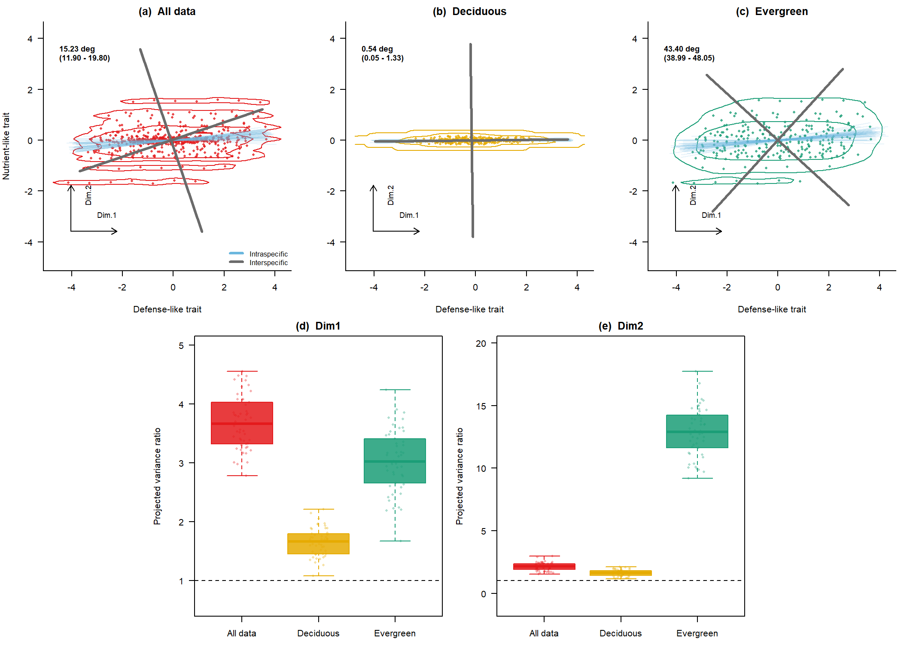

# RでPrincipal axis regressionをtrait spaceの回転に応用する

r

共分散行列の第1固有ベクトルを使って、種間軸と種内変異を含む軸のずれを調べます

公開

2026-05-27

更新日

2026-05-27

[English version](../../en/posts/2026-05-27-r-principle-axis-regression_example/)

前回の記事 [Rで2変量PCAとPrincipal axis regressionの基礎を理解する](../2026-05-26-r-principle-axis-regression/) では、2変量データの共分散行列を固有値分解し、第1固有ベクトルを主軸として描くところまでを確認しました。 本記事では、その考え方を少し進めて、種ごとの代表値から求めた主軸と、種内変異を含めたときの主軸がどれくらいずれるかを調べます。

ここでいう principal axis regression (PAR) は、前回と同じく、共分散行列の第1固有ベクトルを2変量データの主軸として使う方法です。 文献上は、major axis (MA) や standardised major axis (SMA) などの2変量 line-fitting 方法として整理されることが多く、本記事の実装はこのうち共分散行列ベースのMAに近い考え方です ([Warton ほか 2006年](#ref-warton2006))。

応用例の発想は、Zhou et al. ([2025年](#ref-zhou2025)) が扱っている「種間レベルの trait space と、種内変異を含めた trait space の向きの違い」という問いにあります。 ただし、本記事は原著論文の図・文章・データを再現するものではありません。 本文中のデータはすべて教育目的で作成した架空データであり、原著論文の数値、図から読み取った座標、解析結果は使用していません。 原著論文の具体的な解析手順や生態学的解釈については、必ず原著論文を参照してください。

## Principal axis regressionの概要

Principal axis regressionは、データの共分散行列を計算し、その固有値と固有ベクトルを求めることで、データの主要な変動方向を特定します。 第1固有ベクトルは、データのばらつきが最も大きい方向を表します。 この方向を直線として描くと、点群の流れを要約する主軸として解釈できます。

ここでは、2つの軸を比較します。

- 種ごとの代表値から求める `interspecific axis`
- 各種から1個体ずつ選んだデータから求める、種内変異を含んだ軸

固有ベクトルの符号は任意なので、軸どうしの角度を計算するときは、反対向きの同じ軸を同じものとして扱います。 また、前回と同じく、`x` と `y` は同じスケールの説明用変数として扱います。 実データで単位やスケールが大きく異なる場合は、log変換、標準化、または相関行列を使うかを別途検討する必要があります。

## Rでの実装

今回の実装では、次の順番で処理します。

1.  種間差と種内差をもつダミーデータを作る
2.  種ごとの代表値を使って、種間レベルの主軸を求める
3.  各種から1個体ずつ取り出して、種内変異を含む主軸を繰り返し推定する
4.  種間レベルの主軸と、種内変異を含む主軸の角度差を計算する
5.  種間軸に沿った分散比を使って、種内変異を含めたときのばらつきの増え方を可視化する

ここで使う `x` と `y` は、実データのtrait名ではなく、説明用の2次元traitです。 `x` を防御形質、`y` を栄養獲得形質のようなものとして読み替えると、種間差と種内差が異なる向きを持つ状況を考えやすくなります。

### データを作る

[`rnorm()`](https://rdrr.io/r/stats/Normal.html)関数を使用して種ごとの中心位置を作り、そのまわりに種内変異を持つ2次元のデータセットを作成します。 種内変異は、種ごとの中央値が中心位置に戻るように、対称なスコアとして作ります。 このデータセットは、2つのグループ（落葉樹っぽいグループと常緑樹っぽいグループ）を含み、各グループ内で種ごとに個体値がばらつくように設計されています。 ここでは、種平均のばらつきと、同じ種の中での個体差を別々の標準偏差で指定できるようにしています。 さらに、種平均が並ぶ方向と種内変異が伸びる方向を別々に指定します。 このようにすると、「種間軸はある方向に伸びるが、種内変異を含めると主軸が別方向に回転する」という状況を、自作データで確認できます。

``` downlit
# Fix the seed so the random simulation gives the same result each time.
set.seed(123)

# Helper function that rotates random values along major and minor directions
# by the specified angle.
# angle_deg = 0 means the x-axis direction, and angle_deg = 45 means a
# 45-degree rising direction.
rotate_xy <- function(major, minor, angle_deg) {
  theta <- angle_deg * pi / 180

  cbind(
    x = major * cos(theta) - minor * sin(theta),
    y = major * sin(theta) + minor * cos(theta)
  )
}

# Create intraspecific values symmetrically so that their median is 0.
# This makes each species median reflect the species mean well.
# At the same time, when one individual is sampled from each species, the
# direction of intraspecific variation can appear strongly.
balanced_scores <- function(n, target_sd) {
  if (target_sd == 0) {
    return(rep(0, n))
  }

  z <- seq(-1, 1, length.out = n)
  z <- z - mean(z)
  z / sd(z) * target_sd
}

sim_group <- function(
  group,
  n_species = 40,
  n_ind = 7,
  sp_major_sd,
  sp_minor_sd,
  sp_angle,
  ind_major_sd,
  ind_minor_sd,
  ind_angle
) {
  # Temporary list for species-level data.
  # At the end, these data frames are combined into one data frame.
  out <- list()

  # Create n_species species within one group.
  for (i in seq_len(n_species)) {
    sp <- paste0(group, "_sp", i)

    # First, decide the center position for this species.
    # sp_major_sd is interspecific spread along the major direction.
    # sp_minor_sd is spread in the direction orthogonal to it.
    # sp_angle controls the direction in which species means are arranged.
    sp_mean <- rotate_xy(
      major = rnorm(1, mean = 0, sd = sp_major_sd),
      minor = rnorm(1, mean = 0, sd = sp_minor_sd),
      angle_deg = sp_angle
    )

    # Next, generate individual values around the species mean.
    # ind_major_sd is intraspecific spread along the major direction.
    # ind_minor_sd is spread in the orthogonal direction.
    # Here, values within each species are symmetric around the species mean.
    # As a result, species medians preserve the interspecific axis, while
    # one-individual sampling reveals intraspecific differences.
    ind_major <- sample(balanced_scores(n_ind, ind_major_sd), size = n_ind)
    ind_minor <- sample(balanced_scores(n_ind, ind_minor_sd), size = n_ind)

    # ind_angle controls the direction in which individual differences within
    # the same species extend.
    ind_dev <- rotate_xy(
      major = ind_major,
      minor = ind_minor,
      angle_deg = ind_angle
    )

    x <- as.numeric(sp_mean[, "x"]) + ind_dev[, "x"]
    y <- as.numeric(sp_mean[, "y"]) + ind_dev[, "y"]

    # Keeping group, species, and individual columns makes later operations
    # easier, such as calculating representative values for each species and
    # sampling one individual from each species.
    out[[i]] <- data.frame(
      group = group,
      species = sp,
      individual = seq_len(n_ind),
      x = x,
      y = y
    )
  }

  # Combine the species-level data frames row-wise.
  do.call(rbind, out)
}

# Deciduous-like group.
# Both interspecific differences and individual differences mainly appear in
# the x direction.
# Therefore, the interspecific axis and the axis including intraspecific
# variation hardly rotate.
dat_D <- sim_group(
  group = "D",
  n_species = 40,
  n_ind = 7,
  sp_major_sd = 1.0,
  sp_minor_sd = 0.05,
  sp_angle = 0,
  ind_major_sd = 0.7,
  ind_minor_sd = 0.05,
  ind_angle = 0
)

# Evergreen-like group.
# Species means are arranged diagonally, while individual differences are made
# strong in the x direction.
# This intentionally shifts the interspecific axis and the axis including
# intraspecific variation.
dat_E <- sim_group(
  group = "E",
  n_species = 40,
  n_ind = 7,
  sp_major_sd = 0.75,
  sp_minor_sd = 0.35,
  sp_angle = 55,
  ind_major_sd = 1.8,
  ind_minor_sd = 0.04,
  ind_angle = 0
)

# Combine the two groups so they can also be treated as all data.
dat <- rbind(dat_D, dat_E)
```

### 相関を確認する

それぞれのグループ内で、xとyの相関を確認してみましょう。 相関が小さいことを確認できます。 ここで相関を見ているのは、単純な「右上がり・右下がり」の関係が強くない場合でも、分散の向きとして主軸を求められることを示すためです。

``` downlit
tapply(seq_len(nrow(dat)), dat$group, function(i) {
  # tapply() retrieves row numbers for each group, and the correlation
  # coefficient between x and y is calculated from those rows.
  cor(dat$x[i], dat$y[i])
})
```

            D         E 
    0.1066764 0.2091585 

### principal axis を求める関数

この関数では、2次元データから共分散行列を作り、その固有ベクトルをprincipal axisとして取り出します。 第1固有ベクトルはもっとも分散が大きい方向、第2固有ベクトルはそれに直交する方向です。

``` downlit
principal_axis <- function(x, y) {
  # Combine x and y into a two-column matrix.
  # Each row is one individual or one species, and each column is one trait.
  X <- cbind(x, y)

  # Covariance matrix.
  # Diagonal entries are the variances of x and y.
  # Off-diagonal entries are the covariance between x and y.
  S <- cov(X)

  # Eigen decomposition.
  # eigen() returns eigenvalues and eigenvectors in descending order of
  # variance.
  eg <- eigen(S, symmetric = TRUE)

  vectors <- eg$vectors

  # Stabilise display by making the x direction positive.
  # Eigenvectors represent the same axis even if their sign is flipped, so this
  # prevents the line direction from flipping each time it is plotted.
  for (j in seq_len(ncol(vectors))) {
    if (vectors[1, j] < 0) {
      vectors[, j] <- -vectors[, j]
    }
  }

  v1 <- vectors[, 1]

  # Return values used later for calculation and plotting.
  list(
    covariance = S,
    eigenvalues = eg$values,
    vectors = vectors,
    first_vector = v1,
    first_eigenvalue = eg$values[1],
    center = colMeans(X),
    # Angle of the first principal axis from the x-axis.
    # atan2() directly calculates the angle from the x and y components of the
    # vector.
    angle_from_x = atan2(v1[2], v1[1]) * 180 / pi
  )
}

angle_between_axes <- function(v1, v2) {
  # Calculate the angle between two vectors from their inner product.
  # abs() treats the same axis in the opposite direction as 0 degrees.
  cos_angle <- abs(sum(v1 * v2) / sqrt(sum(v1^2) * sum(v2^2)))
  cos_angle <- min(1, max(0, cos_angle))
  acos(cos_angle) * 180 / pi
}

variance_along_axis <- function(x, y, axis) {
  # Project the data onto the specified axis and calculate the variance along
  # that direction.
  # var() uses deviations from the mean, so explicit centering is not needed
  # here.
  scores <- as.vector(cbind(x, y) %*% axis)
  var(scores)
}
```

principal_axis() は、要するに以下の処理を行っています。

``` downlit
eigen(cov(cbind(x, y)), symmetric = TRUE)
```

### 種平均の trait space を作る

実データでは、形質の分布やスケールに応じて、log変換や代表値の選び方を慎重に決める必要があります。 今回は説明用の架空データなので、単純に種ごとの中央値をとってみます。 ここで作る `species_med` は、種ごとに1点だけを持つデータです。 したがって、このデータから求める主軸は、種間差を反映した `interspecific axis` とみなせます。

``` downlit
species_med <- aggregate(
  # Aggregate x and y at the same time.
  cbind(x, y) ~ group + species,
  data = dat,
  # Use the median rather than the mean.
  # This can be treated as a representative value that is somewhat robust to
  # outliers.
  FUN = median
)
head(species_med)
```

      group species           x           y
    1     D   D_sp1 -0.56047565 -0.01150887
    2     D  D_sp10  0.54839696  0.01193659
    3     D  D_sp11  0.03768285  0.05881101
    4     D  D_sp12 -0.05556197  0.02597036
    5     D  D_sp13  1.87141801  0.03014352
    6     D  D_sp14 -0.42249683 -0.10266236

### 種平均ベースの主軸 interspecific axis

まずは落葉樹っぽいグループと常緑樹っぽいグループを分けて、種平均ベースの主軸を求めます。 この時点では、各種の中に複数個体があることは無視され、各種が1点で表されています。

``` downlit
pa_inter_D <- with(
  # Use only species medians from the deciduous-like group.
  subset(species_med, group == "D"),
  principal_axis(x, y)
)

pa_inter_E <- with(
  # Use only species medians from the evergreen-like group.
  subset(species_med, group == "E"),
  principal_axis(x, y)
)

# Check the angle of the first principal axis from the x-axis.
pa_inter_D$angle_from_x
```

    [1] 0.7338449

``` downlit
pa_inter_E$angle_from_x
```

    [1] 47.56799

これが、論文でいう interspecific eigenvector に相当します。

### 各種から1個体ずつランダムに選ぶ

ここでは、種ごとのサンプル数の影響をそろえるため、各反復で「各種から1個体」を選びます。 この処理により、種数はそのままにしつつ、種内変異を反映した個体レベルのtrait spaceを繰り返し作れます。

``` downlit
sample_one_per_species <- function(d) {
  # Split the data frame by species.
  sp_list <- split(d, d$species)

  sampled <- lapply(sp_list, function(z) {
    # Randomly select one row from each species.
    z[sample(seq_len(nrow(z)), 1), ]
  })

  # Combine the selected individuals back into one data frame.
  do.call(rbind, sampled)
}
```

### 50回リサンプリングして rotation angle を計算する

`run_resampling()` は、作図に使う値をまとめて計算する関数です。 入力は、個体レベルのデータ `dat_group` と、種代表値のデータ `species_med_group` です。 出力には、種間軸、リサンプリングごとの種内軸、軸の角度差、種間軸方向の分散比が入ります。

``` downlit
run_resampling <- function(dat_group, species_med_group, n_iter = 50) {
  # Principal axis estimated from species representative values.
  # This is used as the reference interspecific axis.
  pa_inter <- principal_axis(
    species_med_group$x,
    species_med_group$y
  )

  # Prepare vectors and lists for iteration-level results.
  angles <- numeric(n_iter)
  eig_ratio_dim1 <- numeric(n_iter)
  eig_ratio_dim2 <- numeric(n_iter)
  axes <- vector("list", n_iter)
  samples <- vector("list", n_iter)

  for (i in seq_len(n_iter)) {
    # Select one individual from each species.
    # This one set becomes a trait space reflecting intraspecific variation.
    sampled <- sample_one_per_species(dat_group)

    # Estimate the principal axis from the sampled individual data.
    # This is treated as the axis including intraspecific variation.
    pa_intra <- principal_axis(
      sampled$x,
      sampled$y
    )

    # Angular difference between the interspecific axis and the axis including
    # intraspecific variation.
    # This expresses how far the axis rotated from the interspecific axis.
    angles[i] <- angle_between_axes(
      pa_inter$first_vector,
      pa_intra$first_vector
    )

    # Check how much the projected variance along the first interspecific axis
    # increases compared with species representative values only.
    # A value greater than 1 means variation has increased along that
    # interspecific-axis direction.
    eig_ratio_dim1[i] <- variance_along_axis(
      sampled$x,
      sampled$y,
      pa_inter$vectors[, 1]
    ) / pa_inter$eigenvalues[1]

    # Calculate the same ratio for the second interspecific axis.
    eig_ratio_dim2[i] <- variance_along_axis(
      sampled$x,
      sampled$y,
      pa_inter$vectors[, 2]
    ) / pa_inter$eigenvalues[2]

    # Save the axes and samples so they can be plotted later.
    axes[[i]] <- pa_intra
    samples[[i]] <- sampled
  }

  list(
    pa_inter = pa_inter,
    angles = angles,
    eig_ratio = eig_ratio_dim1,
    eig_ratio_dim1 = eig_ratio_dim1,
    eig_ratio_dim2 = eig_ratio_dim2,
    axes = axes,
    samples = samples
  )
}

res_all <- run_resampling(
  # Case using all data together.
  dat_group = dat,
  species_med_group = species_med,
  n_iter = 50
)

res_D <- run_resampling(
  # Apply the same procedure to the deciduous-like group only.
  dat_group = subset(dat, group == "D"),
  species_med_group = subset(species_med, group == "D"),
  n_iter = 50
)

res_E <- run_resampling(
  # Apply the same procedure to the evergreen-like group only.
  dat_group = subset(dat, group == "E"),
  species_med_group = subset(species_med, group == "E"),
  n_iter = 50
)
```

### 結果の確認

まず、角度差と分散比の分布を数値で確認します。 `angles` は種間軸からどれくらい回転したかを表します。 `eig_ratio_dim1` と `eig_ratio_dim2` は、種間軸の第1軸・第2軸それぞれに沿った分散が、種内変異を含めたサンプリングでどれくらい増えたかを表します。

``` downlit
# Rotation angles of the principal axis.
summary(res_all$angles)
```

       Min. 1st Qu.  Median    Mean 3rd Qu.    Max. 
      11.13   13.44   14.81   15.23   16.89   21.29 

``` downlit
summary(res_D$angles)
```

       Min. 1st Qu.  Median    Mean 3rd Qu.    Max. 
    0.03909 0.30727 0.50888 0.53914 0.69654 1.46247 

``` downlit
summary(res_E$angles)
```

       Min. 1st Qu.  Median    Mean 3rd Qu.    Max. 
      37.12   42.14   43.19   43.40   44.84   50.02 

``` downlit
# Variance ratio along the first interspecific axis.
summary(res_all$eig_ratio_dim1)
```

       Min. 1st Qu.  Median    Mean 3rd Qu.    Max. 
      2.780   3.322   3.663   3.677   4.014   4.550 

``` downlit
summary(res_D$eig_ratio_dim1)
```

       Min. 1st Qu.  Median    Mean 3rd Qu.    Max. 
      1.087   1.465   1.668   1.659   1.792   2.217 

``` downlit
summary(res_E$eig_ratio_dim1)
```

       Min. 1st Qu.  Median    Mean 3rd Qu.    Max. 
      1.672   2.685   3.024   3.034   3.397   4.235 

``` downlit
# Variance ratio along the second interspecific axis.
summary(res_all$eig_ratio_dim2)
```

       Min. 1st Qu.  Median    Mean 3rd Qu.    Max. 
      1.522   1.915   2.143   2.127   2.359   2.964 

``` downlit
summary(res_D$eig_ratio_dim2)
```

       Min. 1st Qu.  Median    Mean 3rd Qu.    Max. 
      1.139   1.446   1.644   1.627   1.796   2.106 

``` downlit
summary(res_E$eig_ratio_dim2)
```

       Min. 1st Qu.  Median    Mean 3rd Qu.    Max. 
      9.193  11.629  12.901  12.860  14.168  17.720 

### 自作データの結果をまとめて描く

最後に、種間軸と種内変異を含む軸のずれ、そして種間軸方向の分散比を1枚にまとめます。 この図は、Zhou et al. ([2025年](#ref-zhou2025)) の論点を理解するための自作図であり、原著論文の図を複製したものではありません。 全データ、落葉樹っぽいグループ、常緑樹っぽいグループを並べてみます。

``` downlit
# Colors used across the figure.
# all, D, and E are used for points and contours.
# intra and inter are used for principal axes.
cols <- c(
  all = "#e41a1c",
  D = "#e6ab02",
  E = "#1b9e77",
  intra = "#6bb7de",
  inter = "#6b6b6b"
)

# Draw a line in the direction of the specified eigenvector from the result of
# principal_axis().
# dim = 1 draws the first axis, and dim = 2 draws the second axis.
draw_axis <- function(pa, dim = 1, len = 2, col = "black", lwd = 3, lty = 1) {
  # Place the line center at the center of the data points.
  c0 <- pa$center

  # The eigenvector is a direction vector of length 1.
  # Multiplying by len makes the line long enough to see in the plot.
  v <- pa$vectors[, dim]

  segments(
    x0 = c0[1] - len * v[1],
    y0 = c0[2] - len * v[2],
    x1 = c0[1] + len * v[1],
    y1 = c0[2] + len * v[2],
    col = col,
    lwd = lwd,
    lty = lty
  )
}

# Show where scatter-plot points are concentrated with contour lines.
# MASS::kde2d() estimates a two-dimensional kernel density, and contours are
# overlaid on the scatter plot.
draw_density <- function(x, y, col, xlim, ylim) {
  # Do not stop the main calculations if MASS is unavailable.
  if (!requireNamespace("MASS", quietly = TRUE)) {
    return(invisible(NULL))
  }

  # Specify lims so the three trait panels use density estimates for the same
  # coordinate range.
  dens <- MASS::kde2d(x, y, n = 80, lims = c(xlim, ylim))
  z <- as.vector(dens$z)
  z <- z[z > 0]

  # Draw only the high-density areas as contour lines.
  # These are auxiliary lines showing the main concentration of points.
  contour(
    dens,
    add = TRUE,
    levels = quantile(z, probs = c(0.75, 0.9), names = FALSE),
    drawlabels = FALSE,
    col = col,
    lwd = c(1, 1.4)
  )
}

# Draw small arrows for Dim.1 and Dim.2 in the lower-left corner of each trait
# panel.
# These are schematic arrows that help readers read the figure, not estimated
# axes.
draw_dim_arrows <- function(xlim, ylim) {
  # Decide the start position and length from the panel coordinate range.
  x0 <- xlim[1] + 0.08 * diff(xlim)
  y0 <- ylim[1] + 0.13 * diff(ylim)
  x1 <- x0 + 0.20 * diff(xlim)
  y1 <- y0 + 0.20 * diff(ylim)

  arrows(x0, y0, x1, y0, length = 0.08, lwd = 1.4)
  arrows(x0, y0, x0, y1, length = 0.08, lwd = 1.4)
  text(x1, y0 + 0.06 * diff(ylim), "Dim.1", cex = 0.85, adj = c(1, 0))
  text(x0 + 0.06 * diff(xlim), y1, "Dim.2", cex = 0.85, srt = 90, adj = c(1, 1))
}

# Format the distribution of angles from resampling as a label for the figure.
# Here, the 2.5% and 97.5% quantiles are shown as a simple range.
angle_label <- function(angles) {
  ci <- quantile(angles, probs = c(0.025, 0.975), names = FALSE)

  sprintf(
    "%.2f deg\n(%.2f - %.2f)",
    mean(angles),
    ci[1],
    ci[2]
  )
}

# Draw one upper-row trait-space panel.
# Points, density contours, intraspecific axes, interspecific axes, and the
# angle label are drawn together.
plot_trait_panel <- function(
  dat_group,
  res,
  main,
  panel,
  col,
  xlim,
  ylim,
  show_y_label = FALSE,
  show_legend = FALSE
) {
  # First draw the scatter plot of individual values.
  # asp = 1 makes one unit on the x-axis the same length as one unit on the
  # y-axis.
  plot(
    dat_group$x,
    dat_group$y,
    pch = 16,
    cex = 0.65,
    col = adjustcolor(col, alpha.f = 0.8),
    xlim = xlim,
    ylim = ylim,
    asp = 1,
    xlab = "Defense-like trait",
    ylab = if (show_y_label) "Nutrient-like trait" else "",
    main = paste0("(", panel, ")  ", main),
    bty = "l",
    las = 1
  )

  # Overlay contour lines showing where the points are concentrated.
  draw_density(
    dat_group$x,
    dat_group$y,
    col = col,
    xlim = xlim,
    ylim = ylim
  )

  # Length of the principal-axis lines.
  # Using a value relative to the coordinate range keeps the appearance
  # consistent across panels.
  axis_len <- 0.42 * min(diff(xlim), diff(ylim))

  # Overlay the first intraspecific axis estimated in each resampling iteration
  # in pale blue.
  # Showing 50 lines makes the direction of axes including intraspecific
  # variation visible.
  for (pa in res$axes) {
    draw_axis(
      pa,
      dim = 1,
      len = axis_len,
      col = adjustcolor(cols["intra"], alpha.f = 0.16),
      lwd = 1
    )
  }

  # Draw the interspecific axis from species representative values as thick
  # gray lines.
  # dim = 1 is the comparison target for the rotation angle, and dim = 2 is the
  # orthogonal axis.
  # The difference between the pale-blue first axes and the gray first axis is
  # the intuitive meaning of the rotation angle.
  draw_axis(res$pa_inter, dim = 1, len = axis_len, col = cols["inter"], lwd = 3)
  draw_axis(res$pa_inter, dim = 2, len = axis_len, col = cols["inter"], lwd = 3)

  # Draw auxiliary Dim.1 / Dim.2 arrows in the lower-left corner.
  draw_dim_arrows(xlim, ylim)

  # Display the mean angle and range in the upper-left corner.
  text(
    xlim[1] + 0.03 * diff(xlim),
    ylim[2] - 0.06 * diff(ylim),
    angle_label(res$angles),
    adj = c(0, 1),
    cex = 0.85,
    font = 2
  )

  # Show the legend only in the first panel.
  if (show_legend) {
    legend(
      "bottomright",
      legend = c("Intraspecific", "Interspecific"),
      col = c(cols["intra"], cols["inter"]),
      lwd = c(3, 3),
      bty = "n",
      cex = 0.8
    )
  }
}

# Draw one lower-row boxplot panel for variance ratios.
# values is a list of three numeric vectors: All data, Deciduous, and
# Evergreen.
plot_ratio_panel <- function(values, panel, main, colors, ylim = NULL) {
  # If the y-axis range is not specified, automatically choose a range that
  # includes both the data and the reference line at 1.
  if (is.null(ylim)) {
    ylim <- range(c(unlist(values), 1))
    ylim <- ylim + c(-0.12, 0.12) * diff(ylim)
  }

  # Compare the distribution of variance ratios among groups with boxplots.
  boxplot(
    values,
    names = c("All data", "Deciduous", "Evergreen"),
    col = adjustcolor(colors, alpha.f = 0.85),
    border = colors,
    outline = FALSE,
    ylim = ylim,
    ylab = "Projected variance ratio",
    main = paste0("(", panel, ")  ", main),
    las = 1
  )

  # Overlay individual resampling results on the boxplots.
  # Slight horizontal jitter makes the amount of variation easier to see.
  for (i in seq_along(values)) {
    stripchart(
      values[[i]],
      at = i,
      vertical = TRUE,
      method = "jitter",
      jitter = 0.12,
      pch = 16,
      cex = 0.6,
      col = adjustcolor(colors[i], alpha.f = 0.35),
      add = TRUE
    )
  }

  # ratio = 1 is the reference line for the variance from species
  # representative values only.
  # Values above 1 indicate increased variation along that interspecific-axis
  # direction.
  abline(h = 1, lty = 2, lwd = 1.4)
}

# Colors corresponding to the three groups in the lower row.
plot_cols <- c(cols["all"], cols["D"], cols["E"])

# Create a common xlim and ylim for the three upper panels from the range of all
# data.
lim <- range(c(dat$x, dat$y))
lim <- lim + c(-0.08, 0.08) * diff(lim)

# Save the current plotting settings so they can be restored at the end.
old_par <- par(no.readonly = TRUE)

# Use layout() to create a five-panel arrangement.
# The upper row has three panels, and the lower row has two centered panels.
layout(
  matrix(
    c(1, 1, 2, 2, 3, 3, 0, 4, 4, 5, 5, 0),
    nrow = 2,
    byrow = TRUE
  ),
  heights = c(1, 1.1)
)

# Make margins slightly smaller so the multiple panels read as one figure.
par(mar = c(4, 4, 2, 1), oma = c(0, 0, 0, 0))

# Upper row: three panels showing rotation in trait space.
plot_trait_panel(
  dat,
  res_all,
  "All data",
  "a",
  cols["all"],
  lim,
  lim,
  TRUE,
  TRUE
)
plot_trait_panel(
  subset(dat, group == "D"),
  res_D,
  "Deciduous",
  "b",
  cols["D"],
  lim,
  lim
)
plot_trait_panel(
  subset(dat, group == "E"),
  res_E,
  "Evergreen",
  "c",
  cols["E"],
  lim,
  lim
)

# Lower left: variance ratio along the first interspecific axis.
plot_ratio_panel(
  list(res_all$eig_ratio_dim1, res_D$eig_ratio_dim1, res_E$eig_ratio_dim1),
  "d",
  "Dim1",
  plot_cols
)

# Lower right: variance ratio along the second interspecific axis.
plot_ratio_panel(
  list(res_all$eig_ratio_dim2, res_D$eig_ratio_dim2, res_E$eig_ratio_dim2),
  "e",
  "Dim2",
  plot_cols
)
```



``` downlit
# Restore the plotting settings.
par(old_par)
```

## 参考文献

Warton, David I., Ian J. Wright, Daniel S. Falster, と Mark Westoby. 2006年. 「Bivariate Line-Fitting Methods for Allometry」. *Biological Reviews* 81 (2): 259–91. <https://doi.org/10.1017/S1464793106007007>.

Zhou, Guangkai, Daniel F. Petticord, Xingchang Wang, ほか. 2025年. 「Intraspecific Variation in the Growth–Defense Trade-Off Among Deciduous and Evergreen Broadleaf Woody Plants」. *New Phytologist*, advance online publication, 11月 23. <https://doi.org/10.1111/nph.70781>.
