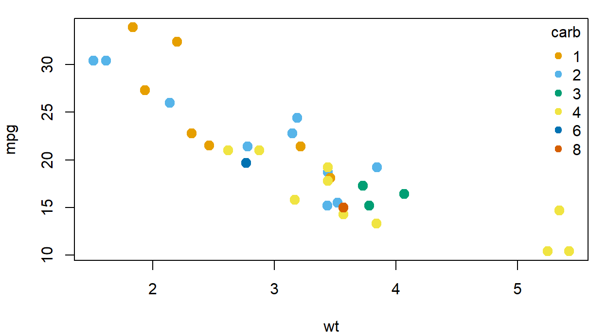
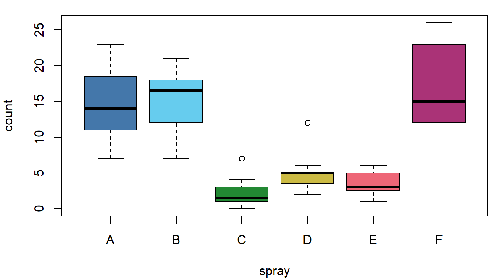
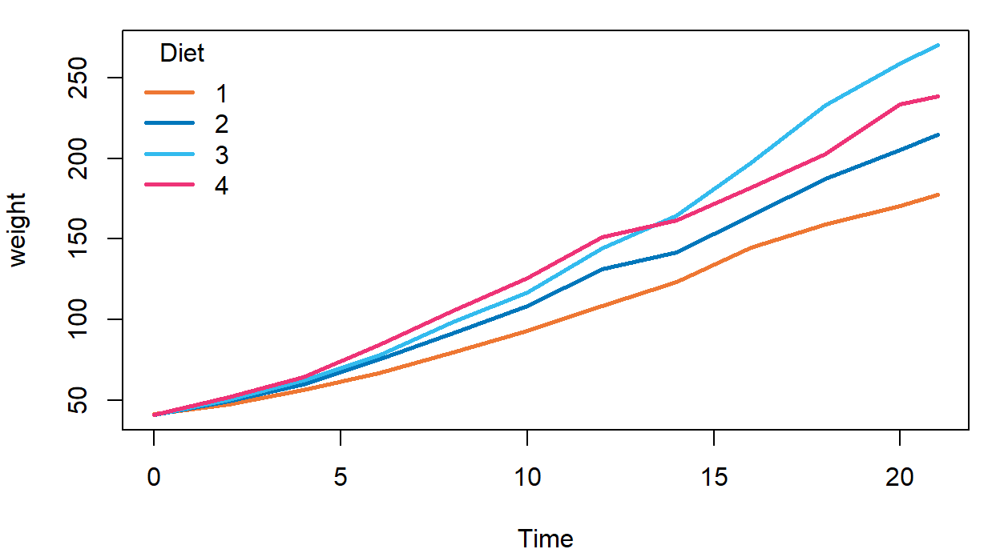
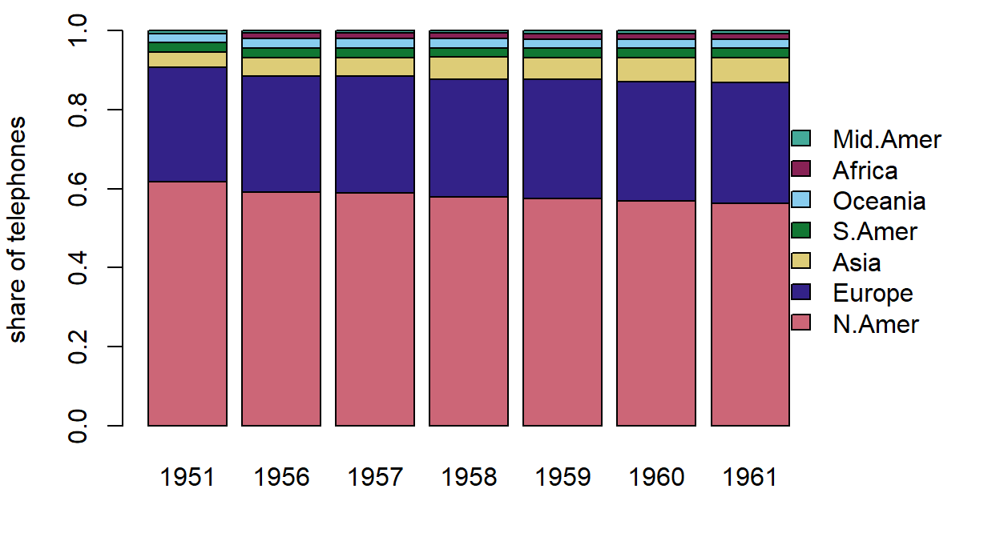
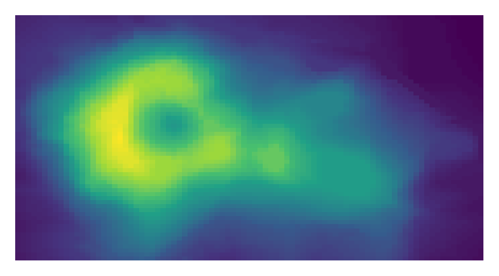
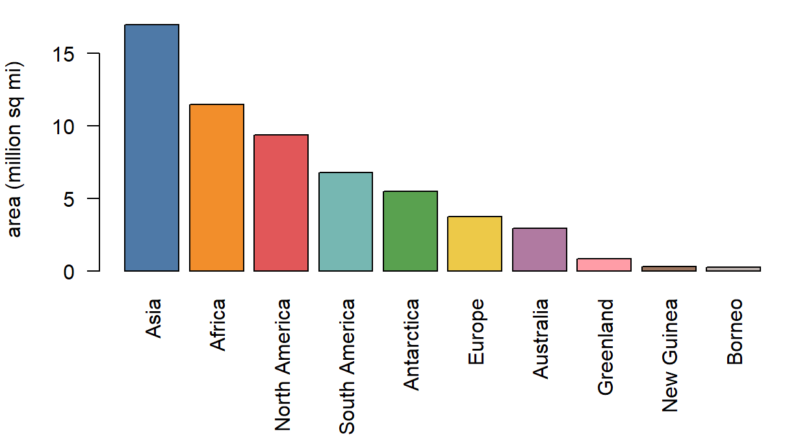
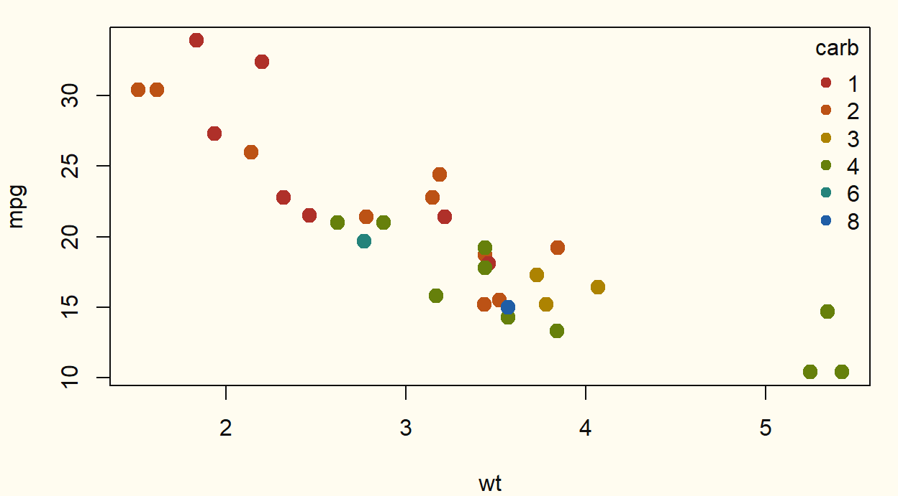
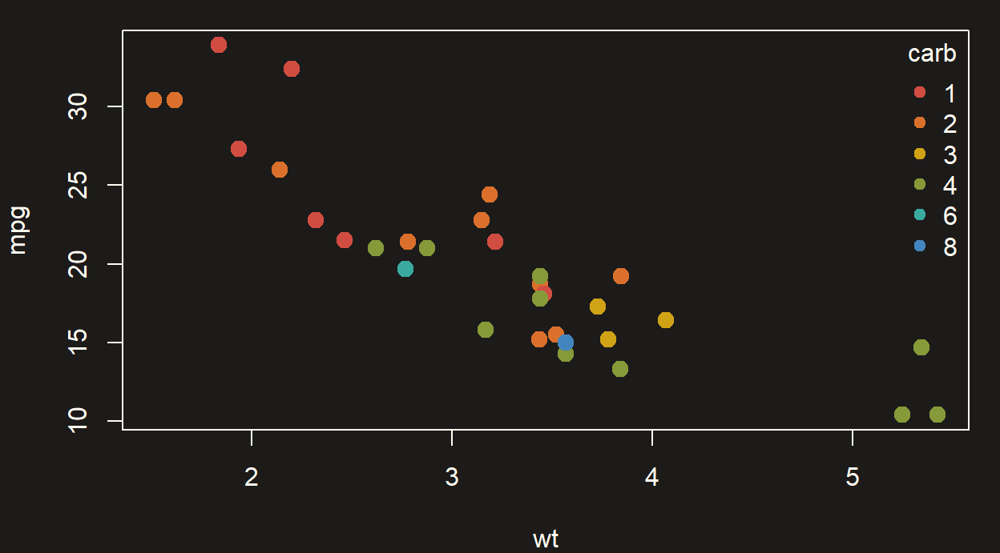

# Okabe-Ito などのカラーパレット一覧（クリックでコピー）

color

visualization

Okabe-Ito、Paul Tol、viridis などのパレットを色見本で一覧にし、カラーコードをクリックでコピーできるようにしました。R・Python・CSS向けの一括コピーにも対応しています。

公開

2026-11-07

更新日

2026-11-07

[English version](../../en/posts/2026-11-07-color-palettes/)

図の色を選ぶたびに、パレットのカラーコードを調べ直すのが面倒でした。 そこで、よく使うパレットを色見本として一か所にまとめ、**クリックするだけでコピーできる**ようにしました。

## 使い方

- 色見本をクリックすると、その色のコードをクリップボードにコピーします。
- 下のスイッチで、コピーする形式を HEX・RGB・HSL から選べます。選んだ形式は次回以降も保持されます。
- 各パレットの下にある「まとめてコピー」で、パレット全体を **R**（`c(...)`）、**Python**（リスト）、**CSS**（カスタムプロパティ）、**JSON** などの形式でコピーできます。

以下の例は、追加のパッケージを使わず、Rの基本のグラフィックスだけで描きます。

## 色覚多様性に配慮したパレット

色の見え方には個人差があります。 赤と緑、青と紫のように、色相だけで区別する配色は、人によっては判別しにくくなります。 次のパレットは、そうした見え方の違いを考慮して作られています。シミュレーションの方法は[Rで色覚異常のシミュレーションを行う方法](../2026-03-04-r-color-blind/)で紹介しています。

### Okabe-Ito

岡部正隆氏と伊藤啓氏が提案した8色のパレットです ([Okabe と Ito 2008年](#ref-okabe2008))。 Nature Methods の記事でも紹介され ([Wong 2011年](#ref-wong2011))、論文の図でよく使われます。 R（4.0以降）では `palette.colors(palette = "Okabe-Ito")` で取得できます ([R Core Team, 日付なし](#ref-rpalette))。[^1] ただし、R の組み込み版は、末尾に灰色（`#999999`）を加えた9色です。[^2]

例として、`mtcars` の車の重さと燃費の散布図を、キャブレターの数（`carb`）で色分けします。R の組み込み版から、黒と灰色を除いた7色を取り出して使います。

``` downlit
# 9 colors: black, 7 chromatic colors, gray. Keep the 7 chromatic ones.
okabe_ito <- unname(palette.colors(palette = "Okabe-Ito"))[2:8]
carb <- factor(mtcars$carb)

par(mar = c(4, 4, 1, 1))
plot(mtcars$wt, mtcars$mpg, col = okabe_ito[carb], pch = 19, cex = 1.4,
     xlab = "wt", ylab = "mpg")
legend("topright", legend = levels(carb), title = "carb", pch = 19,
       col = okabe_ito[seq_len(nlevels(carb))], bty = "n")
```



### Paul Tol: Bright

オランダの宇宙研究機関 SRON の研究者 Paul Tol が整理した配色集の1つです。 Bright・Vibrant・Muted はいずれも、論文ではなく、SRON のテクニカルノートとして公開された配色集に含まれます ([Tol 2021年](#ref-tol2021))。 7色で、Okabe-Ito より落ち着いた発色です。

例として、殺虫剤の種類（`spray`）ごとの害虫の数を、箱ひげ図で示します（`InsectSprays`）。

``` downlit
tol_bright <- c("#4477AA", "#66CCEE", "#228833", "#CCBB44",
                "#EE6677", "#AA3377", "#BBBBBB")

par(mar = c(4, 4, 1, 1))
boxplot(count ~ spray, data = InsectSprays, col = tol_bright)
```



### Paul Tol: Vibrant

Bright より彩度が高く、オレンジを含みます。 明るい背景でも暗い背景でも目立ちやすい配色です。

例として、ヒナの体重の平均を餌（`Diet`）ごとに折れ線で示します。

``` downlit
tol_vibrant <- c("#EE7733", "#0077BB", "#33BBEE", "#EE3377",
                 "#CC3311", "#009988", "#BBBBBB")

# mean weight at each Time (rows) for each Diet (columns)
m <- with(ChickWeight, tapply(weight, list(Time, Diet), mean))
cols <- tol_vibrant[seq_len(ncol(m))]

par(mar = c(4, 4, 1, 1))
matplot(as.numeric(rownames(m)), m, type = "l", lty = 1, lwd = 2.5,
        col = cols, xlab = "Time", ylab = "weight")
legend("topleft", legend = colnames(m), title = "Diet",
       col = cols, lty = 1, lwd = 2.5, bty = "n")
```



### Paul Tol: Muted

10色まで必要な場合に使えるパレットです。彩度を抑えているため、色数が多くても画面がうるさくなりにくい一方、隣り合う色の差は小さめです。

例として、世界の地域別の電話の台数（`WorldPhones`）の構成比を、年ごとに積み上げます。地域は7つあるので、Muted の10色のうち7色を使います。

``` downlit
tol_muted <- c("#CC6677", "#332288", "#DDCC77", "#117733", "#88CCEE",
               "#882255", "#44AA99", "#999933", "#AA4499", "#DDDDDD")

# rows: regions, columns: years, each column sums to 1
share <- t(prop.table(WorldPhones, margin = 1))

par(mar = c(4, 4, 1, 6), xpd = TRUE) # xpd lets the legend sit in the margin
barplot(share, col = tol_muted[seq_len(nrow(share))],
        ylab = "share of telephones", legend.text = rownames(share),
        args.legend = list(x = "right", inset = c(-0.2, 0), bty = "n"))
```



## 連続値向けのパレット

### viridis

[Matplotlib](https://matplotlib.org/) の旧既定カラーマップ `jet` に代わるものとして、Stéfan van der Walt と Nathaniel Smith が設計しました ([Smith と van der Walt 2015年](#ref-smith2015))。 Matplotlib 2.0 から既定になり、R では `viridis` パッケージで使えます ([Garnier ほか 2024年](#ref-garnier2024))。

のちに論文でも取り上げられ、PLOS ONE の Nuñez らの論文では、viridis が現在の標準的なカラーマップ（“gold standard”）として紹介されています ([Nuñez ほか 2018年](#ref-nunez2018))。 また、この論文は、viridis をもとに色覚多様性の観点でさらに最適化した **cividis** を提案しています。 一方で、viridis は通常の色覚に対して最適なカラーマップで、色覚多様性に特化して最適化したものではない、とも述べています。

このカラーパレットは、低い値から高い値へ、明るさが単調に変化するパレットです。 ヒートマップなど、数値の大小を色で表す図に向いています。 ここでは8段階を抜き出しています。上の帯は、8色をなめらかにつないだ見本です。

例として、火山の標高データ（`volcano`）をヒートマップで示します。8色の間を補間して256色にしています。 なお、基本のRの `hcl.colors(256, "viridis")` でも似た配色を使えますが、色の値は少し異なります。

``` downlit
viridis_8 <- c("#440154", "#46337E", "#365C8D", "#277F8E",
               "#1FA187", "#4AC16D", "#9FDA3A", "#FDE725")

# interpolate the 8 colors to 256 steps
pal <- colorRampPalette(viridis_8, space = "Lab")(256)

par(mar = c(1, 1, 1, 1))
image(volcano, col = pal, axes = FALSE)
```



## ほかのよく見るパレット

これらは色覚多様性への配慮を目的に作られたものではありません。 使う場合は、色だけに頼らず、線種・マーカー・ラベルなども併用すると安全です。

### Tableau 10

[Tableau](https://www.tableau.com/) が2016年の Tableau 10 で刷新した、標準のカテゴリ向けパレットです ([Stone 2016年](#ref-stone2016))。 ダッシュボードなどで見慣れた配色で、10色あります。 R にも `palette.colors(palette = "Tableau 10")` として組み込まれています ([R Core Team, 日付なし](#ref-rpalette))。

例として、世界の主要な陸地（`islands`）のうち、面積が大きい10か所を棒グラフにします。R に組み込まれた Tableau 10 の10色を、1本ずつ割り当てます。

``` downlit
tableau10 <- unname(palette.colors(palette = "Tableau 10"))
top10 <- sort(islands, decreasing = TRUE)[1:10]

par(mar = c(7, 4, 1, 1)) # leave room for the labels
barplot(top10 / 1000, col = tableau10, las = 2, ylab = "area (million sq mi)")
```



### Flexoki（このサイトの配色）

[Flexoki](https://stephango.com/flexoki) は、Steph Ango さんが開発した配色システムです。 このサイトの背景色などは、Steph Ango さんの配色システム [Flexoki](https://stephango.com/flexoki) をもとにしています。 アクセントカラーは、明るい背景向けの 600 と、暗い背景向けの 400 があります。

例として、Flexoki の紙の色（`#FFFCF0`）を背景にして、600 のアクセントで、Okabe-Ito の例と同じ散布図を描きます。

``` downlit
flexoki_600 <- c("#AF3029", "#BC5215", "#AD8301", "#66800B",
                 "#24837B", "#205EA6", "#5E409D", "#A02F6F")
carb <- factor(mtcars$carb)

# background (bg), axis lines and text (fg) colors
op <- par(mar = c(4, 4, 1, 1), bg = "#FFFCF0", fg = "#100F0F",
          col.axis = "#100F0F", col.lab = "#100F0F")
plot(mtcars$wt, mtcars$mpg, col = flexoki_600[carb], pch = 19, cex = 1.4,
     xlab = "wt", ylab = "mpg")
legend("topright", legend = levels(carb), title = "carb", pch = 19,
       col = flexoki_600[seq_len(nlevels(carb))], bty = "n", text.col = "#100F0F")
```



``` downlit
par(op) # restore the previous settings
```

例として、暗い背景（`#1C1B1A`）に 400 のアクセントを使い、同じ散布図を描きます。

``` downlit
flexoki_400 <- c("#D14D41", "#DA702C", "#D0A215", "#879A39",
                 "#3AA99F", "#4385BE", "#8B7EC8", "#CE5D97")
carb <- factor(mtcars$carb)

op <- par(mar = c(4, 4, 1, 1), bg = "#1C1B1A", fg = "#FFFCF0",
          col.axis = "#FFFCF0", col.lab = "#FFFCF0")
plot(mtcars$wt, mtcars$mpg, col = flexoki_400[carb], pch = 19, cex = 1.4,
     xlab = "wt", ylab = "mpg")
legend("topright", legend = levels(carb), title = "carb", pch = 19,
       col = flexoki_400[seq_len(nlevels(carb))], bty = "n", text.col = "#FFFCF0")
```



``` downlit
par(op)
```

## コードで使う

### R

「まとめてコピー」の **R** で得られるベクトルは、[`palette()`](https://rdrr.io/r/grDevices/palette.html) に設定すると、色を番号や因子で指定する図にそのまま使えます。

``` downlit
okabe_ito <- c("#E69F00", "#56B4E9", "#009E73", "#F0E442",
               "#0072B2", "#D55E00", "#CC79A7")

palette(okabe_ito) # set as R's current palette
plot(mtcars$wt, mtcars$mpg, col = factor(mtcars$carb), pch = 19)
palette("default") # restore the default
```

### Python

**Python** でコピーしたリストは、Matplotlib の色サイクルに設定できます。

``` python
import matplotlib.pyplot as plt

okabe_ito = ["#E69F00", "#56B4E9", "#009E73", "#F0E442",
             "#0072B2", "#D55E00", "#CC79A7"]
plt.rcParams["axes.prop_cycle"] = plt.cycler(color=okabe_ito)
```

### CSS

**CSS** でコピーした行は、`:root` に貼り付けるとカスタムプロパティとして使えます。

``` css
:root {
  --okabe-ito-orange: #E69F00;
  --okabe-ito-sky-blue: #56B4E9;
}
```

## このページの仕組み

このページの色見本は、画像ではなく、ブラウザー上でJavaScriptが描いています（色見本の下のRの図は、レンダリング時にRで作った画像です）。 ライブラリーは使っておらず、次の3つのファイルだけで動きます。

| ファイル           | 役割                                            |
|--------------------|-------------------------------------------------|
| `palettes-data.js` | 色のデータ（名前とHEX）だけを書いた配列         |
| `palette.js`       | データを読み、色見本とコピー機能を組み立てる    |
| `palette.css`      | 見た目。ライト/ダークはサイトのテーマに追従する |

本文には、次のような空のブロックを置いておくだけです。`palette.js` がこの `data-palette` の値でデータを探し、中身を埋めます。

``` markdown
::: {data-palette="okabe-ito"}
:::
```

QMDの先頭では、CSSとJavaScriptを読み込んでいます。

``` yaml
css: palette.css
include-after-body:
  text: |
    <script src="palettes-data.js"></script>
    <script src="palette.js"></script>
```

パレットを増やしたいときは、`palettes-data.js` に項目を足し、本文に空のブロックを置くだけです。 コピーには `navigator.clipboard` を使い、使えない環境では `execCommand("copy")` に切り替えます。

実際のファイルを、折りたたみで載せます。各ファイルの先頭に全体の説明を、途中に節ごとの説明をコメントとして入れています。

> **NOTE:**
>
> ``` javascript
> /*
>  * palettes-data.js — the colors shown in this post
>  * -------------------------------------------------------------------------
>  * This file is data only. palette.js reads it and draws the swatches.
>  *
>  * To add a palette:
>  *   1. Append an object to the array below.
>  *   2. In index.qmd, place an empty block where it should appear:
>  *        ::: {data-palette="your-id"}
>  *        :::
>  *
>  * Fields of each palette object:
>  *   id      Unique name. Matches data-palette in index.qmd, and prefixes the
>  *           variable names produced by the "CSS" copy button.
>  *   kind    "categorical": distinct colors for groups (legends, bars, lines).
>  *           "sequential":  ordered colors for low-to-high values. These also
>  *                          get a smooth gradient strip above the swatches.
>  *   cvd     true if the palette was designed for color vision diversity.
>  *           Shows a "color-vision friendly" chip. Leave false when unsure.
>  *   source  { label, url } for the credit link. Optional.
>  *   colors  List of [name, hex] pairs, in display order. Use 6-digit hex
>  *           ("#E69F00"). Use null as the name for unnamed colors; they are
>  *           numbered in the CSS output instead.
>  *
>  * Names are English on purpose: they are shared by the Japanese and English
>  * pages, and they double as CSS variable names (--okabe-ito-sky-blue).
>  */
> window.PALETTE_DATA = [
>   {
>     id: "okabe-ito",
>     kind: "categorical",
>     cvd: true,
>     source: { label: "Okabe & Ito (2008)", url: "https://jfly.uni-koeln.de/color/" },
>     colors: [
>       ["Black", "#000000"],
>       ["Orange", "#E69F00"],
>       ["Sky blue", "#56B4E9"],
>       ["Bluish green", "#009E73"],
>       ["Yellow", "#F0E442"],
>       ["Blue", "#0072B2"],
>       ["Vermillion", "#D55E00"],
>       ["Reddish purple", "#CC79A7"],
>     ],
>   },
>   {
>     id: "tol-bright",
>     kind: "categorical",
>     cvd: true,
>     source: { label: "Paul Tol", url: "https://sronpersonalpages.nl/~pault/" },
>     colors: [
>       ["Blue", "#4477AA"],
>       ["Cyan", "#66CCEE"],
>       ["Green", "#228833"],
>       ["Yellow", "#CCBB44"],
>       ["Red", "#EE6677"],
>       ["Purple", "#AA3377"],
>       ["Grey", "#BBBBBB"],
>     ],
>   },
>   {
>     id: "tol-vibrant",
>     kind: "categorical",
>     cvd: true,
>     source: { label: "Paul Tol", url: "https://sronpersonalpages.nl/~pault/" },
>     colors: [
>       ["Orange", "#EE7733"],
>       ["Blue", "#0077BB"],
>       ["Cyan", "#33BBEE"],
>       ["Magenta", "#EE3377"],
>       ["Red", "#CC3311"],
>       ["Teal", "#009988"],
>       ["Grey", "#BBBBBB"],
>     ],
>   },
>   {
>     id: "tol-muted",
>     kind: "categorical",
>     cvd: true,
>     source: { label: "Paul Tol", url: "https://sronpersonalpages.nl/~pault/" },
>     colors: [
>       ["Rose", "#CC6677"],
>       ["Indigo", "#332288"],
>       ["Sand", "#DDCC77"],
>       ["Green", "#117733"],
>       ["Cyan", "#88CCEE"],
>       ["Wine", "#882255"],
>       ["Teal", "#44AA99"],
>       ["Olive", "#999933"],
>       ["Purple", "#AA4499"],
>       ["Pale grey", "#DDDDDD"],
>     ],
>   },
>   {
>     id: "viridis",
>     kind: "sequential",
>     cvd: true,
>     source: { label: "viridis", url: "https://sjmgarnier.github.io/viridisLite/" },
>     colors: [
>       [null, "#440154"],
>       [null, "#46337E"],
>       [null, "#365C8D"],
>       [null, "#277F8E"],
>       [null, "#1FA187"],
>       [null, "#4AC16D"],
>       [null, "#9FDA3A"],
>       [null, "#FDE725"],
>     ],
>   },
>   {
>     id: "tableau-10",
>     kind: "categorical",
>     cvd: false,
>     source: { label: "Tableau", url: "https://www.tableau.com/blog/colors-upgrade-tableau-10-56782" },
>     colors: [
>       ["Blue", "#4E79A7"],
>       ["Orange", "#F28E2B"],
>       ["Red", "#E15759"],
>       ["Teal", "#76B7B2"],
>       ["Green", "#59A14F"],
>       ["Yellow", "#EDC948"],
>       ["Purple", "#B07AA1"],
>       ["Pink", "#FF9DA7"],
>       ["Brown", "#9C755F"],
>       ["Grey", "#BAB0AC"],
>     ],
>   },
>   {
>     id: "flexoki-600",
>     kind: "categorical",
>     cvd: false,
>     source: { label: "Flexoki", url: "https://stephango.com/flexoki" },
>     colors: [
>       ["Red", "#AF3029"],
>       ["Orange", "#BC5215"],
>       ["Yellow", "#AD8301"],
>       ["Green", "#66800B"],
>       ["Cyan", "#24837B"],
>       ["Blue", "#205EA6"],
>       ["Purple", "#5E409D"],
>       ["Magenta", "#A02F6F"],
>     ],
>   },
>   {
>     id: "flexoki-400",
>     kind: "categorical",
>     cvd: false,
>     source: { label: "Flexoki", url: "https://stephango.com/flexoki" },
>     colors: [
>       ["Red", "#D14D41"],
>       ["Orange", "#DA702C"],
>       ["Yellow", "#D0A215"],
>       ["Green", "#879A39"],
>       ["Cyan", "#3AA99F"],
>       ["Blue", "#4385BE"],
>       ["Purple", "#8B7EC8"],
>       ["Magenta", "#CE5D97"],
>     ],
>   },
> ];
> ```

> **NOTE:**
>
> ``` javascript
> /*
>  * palette.js — click-to-copy color palette renderer
>  * -------------------------------------------------------------------------
>  * How the pieces fit together:
>  *
>  *   palettes-data.js   defines window.PALETTE_DATA (the colors)
>  *   index.qmd          places empty blocks such as <div data-palette="okabe-ito">
>  *   palette.js (this)  finds those blocks and fills them with swatches
>  *   palette.css        styles the result
>  *
>  * Two kinds of placeholders are recognized:
>  *
>  *   <div data-palette="ID">   -> one palette: swatches + "Copy all" buttons
>  *   <div data-palette-format> -> the HEX / RGB / HSL switch (optional, once per page)
>  *
>  * No libraries are used. Everything is built with plain DOM APIs.
>  */
> (() => {
>   "use strict";
>
>   // ==== 1. Language ========================================================
>   // Quarto writes the page language into <html lang="...">. The Japanese and
>   // English builds share this file, so UI strings are picked here.
>   const LANG = (document.documentElement.lang || "en").toLowerCase().startsWith("ja") ? "ja" : "en";
>   const TEXT = {
>     ja: {
>       colors: (n) => `${n} 色`,
>       categorical: "カテゴリ向け",
>       sequential: "連続値向け",
>       cvd: "色覚多様性に配慮",
>       copied: "コピーしました",
>       failed: "コピーできませんでした",
>       copyOne: "コピー",
>       copyAll: "まとめてコピー",
>       formatLabel: "コピーする形式",
>       source: "出典",
>     },
>     en: {
>       colors: (n) => `${n} colors`,
>       categorical: "Categorical",
>       sequential: "Sequential",
>       cvd: "Color-vision friendly",
>       copied: "Copied",
>       failed: "Copy failed",
>       copyOne: "Copy",
>       copyAll: "Copy all",
>       formatLabel: "Copy format",
>       source: "Source",
>     },
>   }[LANG];
>
>   // ==== 2. Color helpers ===================================================
>   // The data only stores HEX strings. Everything else is derived from them.
>
>   // "#E69F00" -> [230, 159, 0]
>   const hexToRgb = (hex) => {
>     const n = parseInt(hex.slice(1), 16);
>     return [(n >> 16) & 255, (n >> 8) & 255, n & 255];
>   };
>
>   // sRGB channel (0-255) -> linear light (0-1), as defined by WCAG.
>   const linear = (c) => {
>     const v = c / 255;
>     return v <= 0.04045 ? v / 12.92 : ((v + 0.055) / 1.055) ** 2.4;
>   };
>
>   // Relative luminance: 0 is black, 1 is white. Green counts most because the
>   // eye is most sensitive to it.
>   const luminance = ([r, g, b]) => 0.2126 * linear(r) + 0.7152 * linear(g) + 0.0722 * linear(b);
>
>   // Choose black or white text for a given background. WCAG's contrast ratio
>   // between luminances L1 >= L2 is (L1 + 0.05) / (L2 + 0.05). We compute it
>   // against black (L = 0) and white (L = 1) and take whichever is larger.
>   const inkFor = (hex) => {
>     const L = luminance(hexToRgb(hex));
>     const vsBlack = (L + 0.05) / 0.05;
>     const vsWhite = 1.05 / (L + 0.05);
>     return vsBlack >= vsWhite ? "#0b0b0b" : "#ffffff";
>   };
>
>   // [r, g, b] (0-255) -> [hue 0-360, saturation %, lightness %]
>   const toHsl = ([r8, g8, b8]) => {
>     const r = r8 / 255, g = g8 / 255, b = b8 / 255;
>     const max = Math.max(r, g, b), min = Math.min(r, g, b);
>     const l = (max + min) / 2;
>     const d = max - min; // chroma; 0 means a gray
>     let h = 0, s = 0;
>     if (d !== 0) {
>       s = d / (1 - Math.abs(2 * l - 1));
>       if (max === r) h = ((g - b) / d) % 6;
>       else if (max === g) h = (b - r) / d + 2;
>       else h = (r - g) / d + 4;
>       h *= 60;
>       if (h < 0) h += 360;
>     }
>     return [Math.round(h), Math.round(s * 100), Math.round(l * 100)];
>   };
>
>   // "Okabe Ito" -> "okabe-ito" (used for CSS variable names)
>   const slug = (s) => s.toLowerCase().replace(/[^a-z0-9]+/g, "-").replace(/^-|-$/g, "");
>
>   // ==== 3. What gets copied ================================================
>
>   // (a) One color. The reader picks the format with the switch at the top.
>   const FORMATS = {
>     hex: (hex) => hex.toUpperCase(),
>     rgb: (hex) => `rgb(${hexToRgb(hex).join(", ")})`,
>     hsl: (hex) => {
>       const [h, s, l] = toHsl(hexToRgb(hex));
>       return `hsl(${h}, ${s}%, ${l}%)`;
>     },
>   };
>
>   // (b) A whole palette. Always HEX, because R, Python and CSS all accept it.
>   // The key is the button label; the function receives one palette object.
>   const hexes = (p) => p.colors.map(([, hex]) => hex.toUpperCase());
>   const BULK = {
>     HEX: (p) => hexes(p).join(", "),
>     R: (p) => `c(${hexes(p).map((h) => `"${h}"`).join(", ")})`,
>     Python: (p) => `[${hexes(p).map((h) => `"${h}"`).join(", ")}]`,
>     // Named colors become --palette-colorname; unnamed ones are numbered.
>     CSS: (p) =>
>       p.colors
>         .map(([name, hex], i) => `--${p.id}-${name ? slug(name) : i + 1}: ${hex.toUpperCase()};`)
>         .join("\n"),
>     JSON: (p) => JSON.stringify(hexes(p)),
>   };
>
>   // ==== 4. Clipboard and feedback ==========================================
>
>   // Returns true on success. The modern Clipboard API needs a secure context
>   // (https or localhost), so we fall back to the old execCommand trick, which
>   // also works when the page is opened from file://.
>   const copyText = async (text) => {
>     try {
>       await navigator.clipboard.writeText(text);
>       return true;
>     } catch (_) {
>       // fall through to the legacy path
>     }
>     try {
>       const ta = document.createElement("textarea");
>       ta.value = text;
>       ta.setAttribute("readonly", "");
>       ta.style.cssText = "position:fixed;top:0;left:0;opacity:0"; // keep it out of sight
>       document.body.appendChild(ta);
>       ta.select();
>       const ok = document.execCommand("copy");
>       ta.remove();
>       return ok;
>     } catch (_) {
>       return false;
>     }
>   };
>
>   // Screen-reader announcement. Sighted users see the "Copied" pill; this
>   // hidden live region says the same thing out loud.
>   let live;
>   const announce = (msg) => {
>     if (!live) {
>       live = document.createElement("div");
>       live.className = "visually-hidden"; // Bootstrap's screen-reader-only class
>       live.setAttribute("role", "status");
>       live.setAttribute("aria-live", "polite");
>       document.body.appendChild(live);
>     }
>     live.textContent = "";
>     // Set the text slightly later so an identical message is announced again.
>     setTimeout(() => (live.textContent = msg), 50);
>   };
>
>   // One timer per element, so clicking twice quickly restarts the countdown
>   // instead of clearing the feedback early.
>   const timers = new WeakMap();
>   const later = (node, ms, fn) => {
>     clearTimeout(timers.get(node));
>     timers.set(node, setTimeout(fn, ms));
>   };
>
>   // Show "Copied" on a swatch. CSS draws the pill from the classes below and
>   // reads its text from the data-msg attribute (see palette.css).
>   const flash = (node, ok, text) => {
>     node.dataset.msg = ok ? TEXT.copied : TEXT.failed;
>     node.classList.toggle("is-copied", ok);
>     node.classList.toggle("is-failed", !ok);
>     announce(`${ok ? TEXT.copied : TEXT.failed}: ${text}`);
>     later(node, 1400, () => node.classList.remove("is-copied", "is-failed"));
>   };
>
>   // ==== 5. Single-color format state =======================================
>   // The chosen format is remembered in localStorage as a small convenience.
>   // Storage can be blocked (private windows, strict settings), so every access
>   // is wrapped in try/catch and the page works without it.
>   const STORE_KEY = "palette-copy-format";
>   let format = "hex";
>   try {
>     const saved = localStorage.getItem(STORE_KEY);
>     if (saved && FORMATS[saved]) format = saved;
>   } catch (_) {}
>
>   // Every swatch registers here so a format change can relabel all of them.
>   const swatches = []; // { btn, valueEl, hex, name }
>   const formatButtons = [];
>
>   // Update one swatch's visible value and its accessible name.
>   const refreshSwatch = ({ btn, valueEl, hex, name }) => {
>     const value = FORMATS[format](hex);
>     valueEl.textContent = value;
>     btn.setAttribute("aria-label", `${TEXT.copyOne}: ${name ? name + " " : ""}${value}`);
>   };
>
>   const setFormat = (next) => {
>     format = next;
>     try {
>       localStorage.setItem(STORE_KEY, next);
>     } catch (_) {}
>     swatches.forEach(refreshSwatch);
>     formatButtons.forEach((b) => b.setAttribute("aria-pressed", String(b.dataset.format === next)));
>   };
>
>   // ==== 6. DOM builders ====================================================
>
>   // Tiny helper: el("span", "palette-name", "Orange") -> <span class="palette-name">Orange</span>
>   // textContent is used (never innerHTML), so data can't inject markup.
>   const el = (tag, className, text) => {
>     const node = document.createElement(tag);
>     if (className) node.className = className;
>     if (text != null) node.textContent = text;
>     return node;
>   };
>
>   // One clickable color tile.
>   const buildSwatch = ([name, hex]) => {
>     const btn = el("button", "palette-swatch");
>     btn.type = "button";
>     // CSS reads these two custom properties for the background and text color.
>     btn.style.setProperty("--sw-bg", hex);
>     btn.style.setProperty("--sw-fg", inkFor(hex));
>     if (name) btn.appendChild(el("span", "palette-name", name));
>     const valueEl = el("span", "palette-value");
>     btn.appendChild(valueEl);
>
>     const item = { btn, valueEl, hex, name };
>     swatches.push(item);
>     refreshSwatch(item); // fills in the value text for the current format
>
>     btn.addEventListener("click", async () => {
>       const text = FORMATS[format](hex); // read the format at click time
>       flash(btn, await copyText(text), text);
>     });
>     return btn;
>   };
>
>   // The line above the swatches: count, kind, color-vision note, source link.
>   const buildMeta = (p) => {
>     const meta = el("p", "palette-meta");
>     meta.appendChild(el("span", null, TEXT.colors(p.colors.length)));
>     meta.appendChild(el("span", "palette-chip", p.kind === "sequential" ? TEXT.sequential : TEXT.categorical));
>     if (p.cvd) meta.appendChild(el("span", "palette-chip palette-chip-cvd", TEXT.cvd));
>     if (p.source) {
>       const a = el("a", null, `${TEXT.source}: ${p.source.label}`);
>       a.href = p.source.url;
>       a.target = "_blank";
>       a.rel = "noopener noreferrer"; // don't hand the new tab a reference to this one
>       meta.appendChild(a);
>     }
>     return meta;
>   };
>
>   // The "Copy all: HEX R Python CSS JSON" row under a palette.
>   const buildTools = (p) => {
>     const tools = el("div", "palette-tools");
>     tools.setAttribute("role", "group");
>     tools.setAttribute("aria-label", TEXT.copyAll);
>     tools.appendChild(el("span", "palette-tools-label", TEXT.copyAll));
>
>     Object.entries(BULK).forEach(([label, make]) => {
>       const b = el("button", "palette-btn", label);
>       b.type = "button";
>       b.addEventListener("click", async () => {
>         const ok = await copyText(make(p));
>         // Briefly swap the label for a check mark, then restore it.
>         b.textContent = ok ? `✓ ${label}` : TEXT.failed;
>         b.classList.toggle("is-copied", ok);
>         announce(`${ok ? TEXT.copied : TEXT.failed}: ${label}`);
>         later(b, 1400, () => {
>           b.textContent = label;
>           b.classList.remove("is-copied");
>         });
>       });
>       tools.appendChild(b);
>     });
>     return tools;
>   };
>
>   // Fill one <div data-palette="ID"> placeholder.
>   const renderPalette = (root) => {
>     const p = (window.PALETTE_DATA || []).find((d) => d.id === root.dataset.palette);
>     if (!p) {
>       // A typo in the id should be obvious while writing, not fail silently.
>       root.textContent = `Unknown palette: ${root.dataset.palette}`;
>       return;
>     }
>     root.classList.add("palette");
>     root.replaceChildren(buildMeta(p));
>
>     // Sequential palettes get a smooth gradient strip above the discrete swatches.
>     if (p.kind === "sequential") {
>       const ribbon = el("div", "palette-ribbon");
>       ribbon.setAttribute("aria-hidden", "true"); // decorative
>       ribbon.style.background = `linear-gradient(to right, ${p.colors.map(([, h]) => h).join(", ")})`;
>       root.appendChild(ribbon);
>     }
>
>     const grid = el("div", "palette-grid");
>     p.colors.forEach((c) => grid.appendChild(buildSwatch(c)));
>     root.append(grid, buildTools(p));
>   };
>
>   // Fill the <div data-palette-format> placeholder with the HEX/RGB/HSL switch.
>   const renderFormatSwitch = (root) => {
>     root.classList.add("palette-format");
>     root.setAttribute("role", "group");
>     root.setAttribute("aria-label", TEXT.formatLabel);
>     root.replaceChildren(el("span", "palette-tools-label", TEXT.formatLabel));
>
>     const seg = el("div", "palette-seg");
>     Object.keys(FORMATS).forEach((key) => {
>       const b = el("button", "palette-seg-btn", key.toUpperCase());
>       b.type = "button";
>       b.dataset.format = key;
>       // aria-pressed drives both the screen-reader state and the CSS highlight.
>       b.setAttribute("aria-pressed", String(key === format));
>       b.addEventListener("click", () => setFormat(key));
>       formatButtons.push(b);
>       seg.appendChild(b);
>     });
>     root.appendChild(seg);
>   };
>
>   // ==== 7. Entry point =====================================================
>   // The format switch is built first so the saved format is already applied
>   // when the swatches are created.
>   const init = () => {
>     document.querySelectorAll("[data-palette-format]").forEach(renderFormatSwitch);
>     document.querySelectorAll("[data-palette]").forEach(renderPalette);
>   };
>
>   if (document.readyState === "loading") document.addEventListener("DOMContentLoaded", init);
>   else init();
> })();
> ```

> **NOTE:**
>
> ``` css
> /*
>  * palette.css — styles for the click-to-copy palettes
>  * -------------------------------------------------------------------------
>  * palette.js builds this structure:
>  *
>  *   .palette
>  *     .palette-meta        count, kind chip, source link
>  *     .palette-ribbon      gradient strip (sequential palettes only)
>  *     .palette-grid
>  *       button.palette-swatch  (one per color)
>  *         .palette-name, .palette-value
>  *     .palette-tools       "Copy all" row of .palette-btn
>  *
>  *   .palette-format        HEX / RGB / HSL switch (.palette-seg-btn)
>  *
>  * Theming: everything except the swatches themselves uses Bootstrap's CSS
>  * variables (--bs-body-color, --bs-border-color, ...). Quarto swaps those
>  * when the reader toggles dark mode, so no dark-mode rules are needed here.
>  * The second argument of each var() is a fallback in case a variable is missing.
>  *
>  * The swatch colors come from JS as inline custom properties:
>  *   --sw-bg  the swatch color
>  *   --sw-fg  black or white text, whichever contrasts better
>  */
>
> .palette {
>   margin: 0.75rem 0 2.25rem;
> }
>
> /* ---- meta line ---------------------------------------------------------- */
>
> .palette-meta {
>   display: flex;
>   flex-wrap: wrap;
>   align-items: center;
>   gap: 0.4rem 0.75rem;
>   margin: 0 0 0.7rem;
>   font-size: 0.85rem;
>   color: var(--bs-secondary-color, #6c757d);
> }
>
> .palette-chip {
>   padding: 0.05rem 0.6rem;
>   border: 1px solid var(--bs-border-color, #dee2e6);
>   border-radius: 999px;
>   font-size: 0.78rem;
>   line-height: 1.5;
>   color: var(--bs-body-color);
> }
>
> .palette-chip-cvd {
>   border-color: color-mix(in srgb, var(--bs-link-color, #0d6efd) 55%, transparent);
>   color: var(--bs-link-color, #0d6efd);
> }
>
> /* ---- gradient ribbon (sequential palettes) ------------------------------ */
>
> .palette-ribbon {
>   height: 0.9rem;
>   margin-bottom: 0.6rem;
>   border: 1px solid var(--bs-border-color, #dee2e6);
>   border-radius: 0.45rem;
> }
>
> /* ---- swatches ------------------------------------------------------------ */
>
> .palette-grid {
>   display: grid;
>   grid-template-columns: repeat(auto-fill, minmax(8.5rem, 1fr));
>   gap: 0.6rem;
> }
>
> /* A swatch is a real <button>, so keyboard focus and Enter/Space work for free. */
> .palette-swatch {
>   position: relative;
>   display: flex;
>   flex-direction: column;
>   justify-content: flex-end;
>   align-items: flex-start;
>   gap: 0.1rem;
>   min-height: 6.5rem;
>   padding: 0.7rem 0.8rem;
>   /* A faint outline so very light swatches (yellow, grey) and very dark ones
>      (black on a dark page) don't vanish into the background. */
>   border: 1px solid color-mix(in srgb, var(--bs-body-color, #888) 22%, transparent);
>   border-radius: 0.65rem;
>   background: var(--sw-bg);
>   color: var(--sw-fg);
>   font: inherit;
>   text-align: left;
>   cursor: pointer;
>   transition: transform 0.12s ease, box-shadow 0.12s ease;
> }
>
> .palette-swatch:hover {
>   transform: translateY(-2px);
>   box-shadow: 0 6px 14px rgba(0, 0, 0, 0.18);
> }
>
> .palette-swatch:active {
>   transform: scale(0.98);
> }
>
> .palette-swatch:focus-visible,
> .palette-btn:focus-visible,
> .palette-seg-btn:focus-visible {
>   outline: 3px solid var(--bs-link-color, #0d6efd);
>   outline-offset: 2px;
> }
>
> .palette-name {
>   font-size: 0.8rem;
>   line-height: 1.25;
>   opacity: 0.88;
> }
>
> .palette-value {
>   font-family: var(--bs-font-monospace, ui-monospace, SFMono-Regular, Menlo, Consolas, monospace);
>   font-size: 0.95rem;
>   font-weight: 600;
>   letter-spacing: 0.01em;
> }
>
> /* "Copied" pill. JS adds .is-copied (or .is-failed) for about 1.4 s and puts
>    the message in data-msg. The pill swaps the swatch's text and background
>    colors, so it is readable on any color. */
> .palette-swatch.is-copied::after,
> .palette-swatch.is-failed::after {
>   content: attr(data-msg);
>   position: absolute;
>   top: 0.55rem;
>   right: 0.6rem;
>   padding: 0.1rem 0.55rem;
>   border-radius: 999px;
>   background: var(--sw-fg);
>   color: var(--sw-bg);
>   font-size: 0.72rem;
>   font-weight: 600;
>   line-height: 1.5;
>   animation: palette-pop 0.18s ease-out;
> }
>
> .palette-swatch.is-copied::after {
>   content: "✓ " attr(data-msg);
> }
>
> @keyframes palette-pop {
>   from {
>     opacity: 0;
>     transform: translateY(4px);
>   }
>   to {
>     opacity: 1;
>     transform: none;
>   }
> }
>
> /* ---- toolbars ------------------------------------------------------------ */
>
> .palette-tools,
> .palette-format {
>   display: flex;
>   flex-wrap: wrap;
>   align-items: center;
>   gap: 0.4rem;
> }
>
> .palette-tools {
>   margin-top: 0.8rem;
> }
>
> .palette-format {
>   margin: 0.5rem 0 1.5rem;
> }
>
> .palette-tools-label {
>   margin-right: 0.2rem;
>   font-size: 0.82rem;
>   color: var(--bs-secondary-color, #6c757d);
> }
>
> .palette-btn {
>   padding: 0.2rem 0.7rem;
>   border: 1px solid var(--bs-border-color, #dee2e6);
>   border-radius: 999px;
>   background: transparent;
>   color: var(--bs-body-color);
>   font-family: var(--bs-font-monospace, ui-monospace, Menlo, Consolas, monospace);
>   font-size: 0.8rem;
>   line-height: 1.5;
>   cursor: pointer;
> }
>
> .palette-btn:hover {
>   background: var(--bs-tertiary-bg, rgba(128, 128, 128, 0.12));
> }
>
> .palette-btn.is-copied {
>   border-color: var(--bs-link-color, #0d6efd);
>   color: var(--bs-link-color, #0d6efd);
> }
>
> /* segmented control for the single-color format */
> .palette-seg {
>   display: inline-flex;
>   border: 1px solid var(--bs-border-color, #dee2e6);
>   border-radius: 999px;
>   overflow: hidden;
> }
>
> .palette-seg-btn {
>   padding: 0.25rem 0.9rem;
>   border: 0;
>   background: transparent;
>   color: var(--bs-body-color);
>   font-family: var(--bs-font-monospace, ui-monospace, Menlo, Consolas, monospace);
>   font-size: 0.8rem;
>   cursor: pointer;
> }
>
> .palette-seg-btn + .palette-seg-btn {
>   border-left: 1px solid var(--bs-border-color, #dee2e6);
> }
>
> .palette-seg-btn:hover {
>   background: var(--bs-tertiary-bg, rgba(128, 128, 128, 0.12));
> }
>
> .palette-seg-btn[aria-pressed="true"] {
>   background: var(--bs-body-color);
>   color: var(--bs-body-bg);
> }
>
> @media (max-width: 480px) {
>   .palette-grid {
>     grid-template-columns: repeat(2, minmax(0, 1fr));
>   }
> }
>
> @media (prefers-reduced-motion: reduce) {
>   .palette-swatch,
>   .palette-swatch.is-copied::after,
>   .palette-swatch.is-failed::after {
>     transition: none;
>     animation: none;
>   }
> }
> ```

## 参考文献

Garnier, Simon, Noam Ross, Bob Rudis, Marco Sciaini, Antônio Pedro Camargo, と Cédric Scherer. 2024年. *Viridis: Colorblind-Friendly Color Maps for R*. <https://doi.org/10.32614/CRAN.package.viridis>.

Nuñez, Jamie R., Christopher R. Anderton, と Ryan S. Renslow. 2018年. 「Optimizing Colormaps with Consideration for Color Vision Deficiency to Enable Accurate Interpretation of Scientific Data」. *PLOS ONE* 13 (7): e0199239. <https://doi.org/10.1371/journal.pone.0199239>.

Okabe, Masataka, と Kei Ito. 2008年. *Color Universal Design (CUD) / Colorblind Barrier Free*. <https://jfly.uni-koeln.de/color/>.

R Core Team. 日付なし. *Set or View the Graphics Palette*. The R Foundation for Statistical Computing. 参照 2026年11月7日. <https://stat.ethz.ch/R-manual/R-devel/library/grDevices/html/palette.html>.

Smith, Nathaniel, と Stéfan van der Walt. 2015年. *A Better Default Colormap for Matplotlib*. Talk at SciPy 2015. <https://www.youtube.com/watch?v=xAoljeRJ3lU>.

Stone, Maureen. 2016年. 「How We Designed the New Color Palettes in Tableau 10」. Tableau, 7月 28. <https://www.tableau.com/blog/colors-upgrade-tableau-10-56782>.

Tol, Paul. 2021年. *Colour Schemes*. Technical Note SRON/EPS/TN/09-002. SRON Netherlands Institute for Space Research. <https://sronpersonalpages.nl/~pault/data/colourschemes.pdf>.

Wong, Bang. 2011年. 「Points of View: Color Blindness」. *Nature Methods* 8 (6): 441. <https://doi.org/10.1038/nmeth.1618>.

## 参考リンク

- [Paul Tol’s Notes: Colour schemes](https://sronpersonalpages.nl/~pault/)
- [viridisLite](https://sjmgarnier.github.io/viridisLite/)
- [Flexoki](https://stephango.com/flexoki)

## 脚注

[^1]: [`palette.colors()`](https://rdrr.io/r/grDevices/palette.html) は R 4.0.0 で追加されました。[R の NEWS（Changes in R 4.0.0）](https://github.com/wch/r-source/blob/trunk/doc/NEWS.Rd)の New Features に記載があります。

[^2]: R の開発版ソース [colorstuff.R](https://github.com/wch/r-source/blob/trunk/src/library/grDevices/R/colorstuff.R) の `.palette_colors_hex` で、`"Okabe-Ito"` は9色（最後が `gray = "#999999"`）として定義されています。
