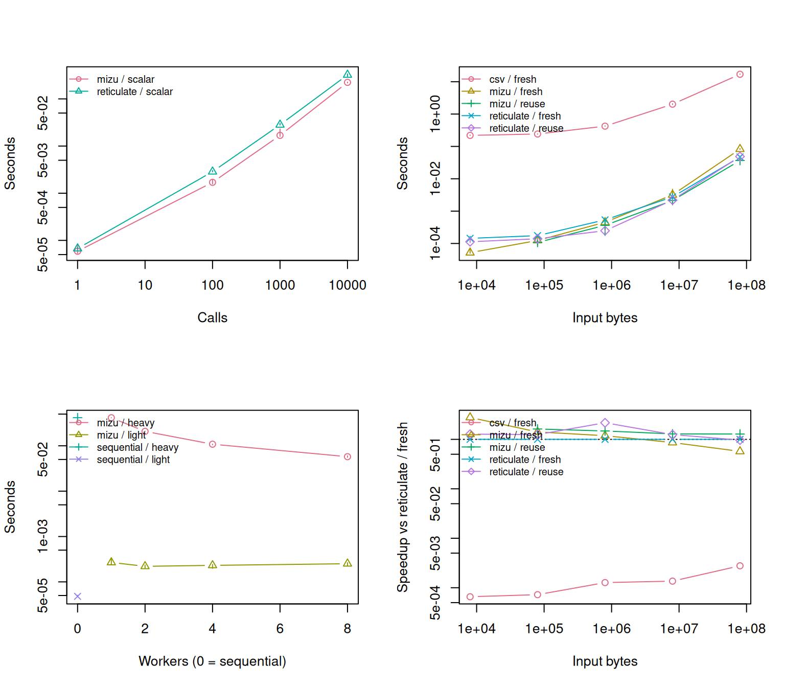

# mizuでRとPythonをつなぐ

r

python

benchmark

RとPythonの間でデータを受け渡す3つの方法（mizu・reticulate・CSV）を比べます。

公開

2026-11-07

更新日

2026-11-07

[English version](../../en/posts/2026-11-07-mizu-r-python/)

## 概要

RとPythonを組み合わせるとき、データをどうやって渡すかで処理時間が大きく変わることがあります。 この記事では、**mizu**（ミズ）という新しいパッケージを、定番の [**reticulate**](https://rstudio.github.io/reticulate/) と **CSVファイル経由** の方法と比べました。

> **NOTE:**
>
> 1.  **80 MBの配列では、入力の渡し方で順位が変わりました。** 毎回Rの元配列から渡す条件では、reticulateが47 ms、mizuが82 msでした。準備済みの入力を再利用する条件では、reticulateが49 ms、mizuが37 msでした。
> 2.  **小さい呼び出しを1万回繰り返すと、mizuの方が短時間で終わりました。** reticulateが322 ms、mizuが224 msでした。
> 3.  **並列化の効果は計算の重さで変わりました。** 重い計算は8ワーカーで逐次実行の約7倍の速さになり、軽い計算は逐次実行が最速でした。
> 4.  **CSVで80 MBを往復させると約17秒かかりました。** この実装では、Pythonの起動とファイルの読み書きが毎回入ります。

ただし、これは1台のWindows PCで測った結果です。 また、mizuはまだ実験段階（バージョン0.1.0）です。数値は目安として読んでください。

## mizuとは

`mizu` は、Rから同じパソコン上の別のプロセスにデータを渡したり、計算を頼んだりするためのパッケージです。 たとえば、Rで用意した配列をPythonに渡し、NumPyで標準化して、結果をRに戻して集計できます。 Rだけで使うこともでき、独立した計算がいくつもあれば、複数のRプロセスに分担させられます。

Pythonとつなぐときは、Python側に `pymizu` を入れます。両者は共通のCライブラリ（[libmizu](https://opensource.posit.co/software/libmizu/)）を使います。 大きな配列など、条件を満たすデータは、両方のプロセスから同じメモリ領域を参照できます。 Linux・macOSではPOSIX共有メモリ、WindowsではWin32のファイルマッピングを使います。

必要な環境は、mizuが**R 4.3**以降、pymizuが64ビットの**Python 3.10**以降です。 NumPyの配列ビューを使うには `pymizu[numpy]` を入れます。 APIは実験段階なので、両側のバージョンと引数を確認しながら使う必要があります。

リンクは以下です。

- [mizu公式サイト](https://shikokuchuo.net/mizu/)
- [mizuソース](https://github.com/shikokuchuo/mizu)
- [pymizuのインストール](https://shikokuchuo.net/pymizu/)

## 比較

RからPythonを呼ぶとき、かかる時間は大きく2つに分かれます。

- **呼び出しの回数にかかる時間**：1回ごとの依頼して、結果を待つ手間。小さい値を何度も渡すときに影響が出ます。
- **データの量にかかる時間**：配列を渡すための変換やコピー。大きい配列を渡すときに影響が出ます。

この2つを分けて測り、「どんな場面でmizuが得なのか」を調べます。

## 3つの方法

| 方法 | しくみ | 特徴 |
|----|----|----|
| **reticulate** | Rの中にPython（CPython）を埋め込み、同じプロセスで動かす | 手軽。配列を別の型に変換するとき、コピーが発生する |
| **mizu** | RとPythonを別プロセスで動かし、**共有メモリ**でデータをやり取りする | 条件が合えばコピーなしで渡せる。ワーカーの起動と停止を自分で書く |
| **CSV** | Rがファイルに書き、Pythonが読み、結果をまたファイルに書く | どんな環境でも使える。変換と読み書きに時間がかかる |

**共有メモリ**とは、複数のプロセスが同じメモリ領域を見られる仕組みです。 データを複製せず、同じ場所を参照できるので、大きいデータでも速く渡せる可能性があります。 これを「ゼロコピー」と呼びます。

### 共有メモリでデータを渡す流れ

- **R → Python**：Rの配列を初めて送るとき、データを共有領域に書き込みます。Pythonは、同じ領域をNumPyの配列として参照します。
- **Python → R**：受け取った値は、Rの **ALTREP**（必要になるまで中身を読み出さない仕組み）として扱われ、必要に応じて共有領域から要素を読みます。
- **再送**：すでに共有領域を参照している配列をそのまま送り直すときは、領域の識別子だけを渡せます。ここが一番速くなる場面です。
- **注意**：計算で新しい結果の配列を作れば、そのメモリ確保と共有領域への書き込みは別に発生します。

共有メモリが使われる大きさの目安は、チャネル（値を直接送受信する経路）で送る属性なしのベクトルや連続した配列で256 KB、それ以外の経路では32 KBです。 経路や版で条件が変わるので、公式ガイドで確認してください。

- [mizuのPython連携ガイド](https://shikokuchuo.net/mizu/articles/interop.html)
- [mizu_callリファレンス](https://shikokuchuo.net/mizu/reference/mizu_call.html)
- [pymizuのR連携ガイド](https://shikokuchuo.net/pymizu/user-guide/interop.html)

### 渡せるデータの型

- **渡せるもの**：`float64`、`int32`、`int64`、`complex128`、`uint8` などの配列、行列、多次元配列、データフレーム、文字列、因子、日付、対応するArrowの列。
- **渡せないもの**：S4オブジェクト、`POSIXlt`、式を属性に持つデータフレーム、一部のArrowの入れ子型やdecimal列など。
- **変換が入るもの**：たとえば `float32` はRのdoubleに拡張されます。論理値や欠損の表現も、型に応じて変換されます。
- **補足**：データフレームはPython側では `pymizu.Frame` になり、Arrowを使うライブラリに渡せます。ただし、Arrowのスキーマが往復で同じになるとは限りません。

詳しくは[型の対応表](https://shikokuchuo.net/pymizu/user-guide/interop.html#the-dtype-matrix)を見てください。

## コード

### RからPythonを呼ぶ

**reticulate**：モジュールを読み込んで、そのまま関数を呼びます。

``` downlit
# Rのプロセス内で動くPythonにNumPyを読み込む。
np <- reticulate::import("numpy")
# Rの1次元配列をNumPyに渡し、平均値（2）をRで受け取る。
np$mean(array(c(1, 2, 3)))
```

**mizu**では、作業用のPythonプロセスをまとめたプールを作ります。 `mizu_call()` は、呼び出す関数と渡す引数をひとまとめにします。この例では、`numpy.mean` に `1, 2, 3` の配列を渡すという指定を、`spec`（specificationの略）という変数に入れています。`mizu_submit_call()` でこの指定をプールに渡すと、Python側で計算が始まります。

``` downlit
# Rとは別にPythonプロセスを1つ起動し、作業を任せるプールを作る。
p <- mizu::mizu_pool(1L, launcher = mizu::mizu_py_launcher())

answer <- tryCatch({
  # 呼ぶ関数と渡す配列を指定する。この時点では計算は始まらない。
  spec <- mizu::mizu_call("numpy.mean", array(c(1, 2, 3)))
  # タスクを投入する。投入枠が空くまで最大10秒待つ。
  task <- mizu::mizu_submit_call(p, spec, .timeout = 10)
  # 結果を最大10秒待つ。時間切れなら mizu_timeout が返る。
  mizu::mizu_collect(task, timeout = 10)
}, finally = {
  # エラーが起きた場合もプールを停止する。
  mizu::mizu_pool_stop(p)
})
```

reticulateはモジュールの読み込みと関数呼び出しの2行です。 mizuではプールの起動と停止が加わります。 プールを使い回す場合、呼び出しごとに必要なのは、関数と引数を指定し、タスクを投入して、結果を受け取ることです。

### PythonからRを呼ぶ

Pythonを起点にするときは、`pymizu.r_launcher()` でRのワーカーを起動します。 次の例は、NumPy配列を [`stats::quantile`](https://rdrr.io/r/stats/quantile.html) に渡します。 `source=` にRコードを渡すこともできます。

``` python
# NumPyで入力配列を作り、pymizuを通じてRに計算を依頼する。
import numpy as np
import pymizu

# Rワーカーを1つ起動する。with ブロックを抜けるとプールが停止する。
with pymizu.Pool.create(1, launcher=pymizu.r_launcher()) as pool:
    # 0から100までの配列について、Rのstats::quantileで
    # 25%、50%、75%の分位点を求めるよう指定する。
    # names=False は、結果に「25%」などの名前を付けない指定。
    spec = pymizu.call(
        "stats::quantile",
        np.arange(101.0),
        probs=np.array([0.25, 0.5, 0.75]),
        names=False,
    )
    # 呼び出しの指定をプールに渡し、結果を回収するためのtaskを受け取る。
    task = pool.submit(spec)
    # 結果を最大10秒待ち、Python側で表示する（25、50、75）。
    print(task.collect(timeout=10))
```

- [pymizuの混合言語プール](https://shikokuchuo.net/pymizu/user-guide/interop.html#mixed-language-pools)

## ベンチマークの方法

次の5つのテストを行いました。

| テスト | 知りたいこと | 内容 |
|----|----|----|
| A | 小さい呼び出しを何度も繰り返すと？ | NumPyの加算を1、100、1,000、10,000回。毎回結果を待つ |
| B | 配列のサイズが大きくなると？ | float64の配列を2倍してRに戻す。8 KB〜80 MBの5段階 |
| C | 逆方向（Python起点）も使えるか？ | R → Python → Rで配列を2倍、Python → R → Pythonで中央値を求める |
| D | 実用的な処理では？ | `mtcars` をNumPyで標準化し、Rで気筒数別の平均を求める |
| E | ワーカーを増やすと？ | 軽い計算と重い計算を、逐次実行と1・2・4・8ワーカーで比べる |

Bでは、次の2つの条件を比べます。

- **fresh**：毎回、Rの元の配列から始めます。mizuでは共有領域への初回の書き込みが、reticulateではNumPy配列への変換が含まれます。
- **reuse**：前の往復で受け取った配列（mizuでは共有ビュー、reticulateでは作成済みのNumPy配列）をそのまま使います。

どちらも、2倍した新しい配列をRに返すところまでを測ります。

> **NOTE:**
>
> - 全方式で、同じPython実行ファイルとNumPyを使います。乱数シードは固定しました。
> - 各条件でウォームアップを1回行い、7回計測して中央値を使います。初回の準備時間は別行に記録しました。
> - 時間は、R側は [`Sys.time()`](https://rdrr.io/r/base/Sys.time.html)、Python側は `perf_counter()` で測りました。結果の照合は計測の外で行っています。
> - mizuの往復時間には、送信・待機・回収を含みます。Python側の演算時間は別に記録しているので、その差にはタスク管理などの時間も入ります。
> - CSVは、1回ごとにPythonを起動する実装です。常駐プロセスでCSVを読む構成なら、起動時間の影響は変わります。
> - Aの1回呼び出しでは、時計の分解能に近い値が出ることがあります。そのため、元のデータをそのまま残しています。
> - Eは、物理コア数とメモリから上限を決め、BLASのスレッド数は1にしました。プールは起動済みの状態で比べます。
> - mizuの8 KBでは、共有ビューを再利用する条件を設けていません（共有される大きさの目安を下回るため）。
> - Arrow IPCやParquetなど、型情報をファイルに保てる形式は今回の対象外です。

## 結果

### 実行環境

- CPU：13th Gen Intel(R) Core(TM) i7-13700F（物理コア16）
- メモリ：64 GB
- OS：Windows 11、R version 4.5.2 (2025-10-31 ucrt)、Python 3.10.11
- パッケージ：mizu 0.1.0、pymizu 0.1.0、reticulate 1.47.0、NumPy 2.2.6
- 反復回数：7回（中央値を使用）

### 準備にかかる時間

| 方式                           | 準備時間（秒） |
|:-------------------------------|---------------:|
| reticulate（Pythonを埋め込む） |           2.86 |
| mizu（Pythonワーカー1つ）      |          0.242 |
| CSV（NumPyが使えるかを確認）   |          0.112 |
| mizu（Rワーカー）              |          0.136 |

reticulateは最初にPythonを読み込むため、約3秒かかりました。mizuは別プロセスを起動するので約0.2秒です。1回しか使わない処理では、この差が全体の時間を左右します。ただし、これは1回だけの測定です。

### A：小さい呼び出しを繰り返す

| 呼び出し回数 | reticulate（ミリ秒） | mizu（ミリ秒） | 1回あたり reticulate（マイクロ秒） | 1回あたり mizu（マイクロ秒） |
|---:|---:|---:|---:|---:|
| 1 | 0.0672 | 0.0589 | 67.2 | 58.9 |
| 100 | 2.86 | 1.7 | 28.6 | 17 |
| 1,000 | 28.2 | 16.8 | 28.2 | 16.8 |
| 10,000 | 322 | 224 | 32.2 | 22.4 |

この測定では、mizuの方が1回あたりの時間が短くなりました。1,000回以上では、reticulateの6〜7割ほどの時間です。mizuは別プロセスなので遅くなると予想していたのですが、そうはなりませんでした。この結果が他の関数や環境でも成り立つかは、確認していません。

### B：配列のサイズを変える

float64の配列を2倍して、Rに戻すまでの時間（ミリ秒）です。**数値が小さいほど速い**ことを表します。

| 配列サイズ | reticulate fresh | reticulate reuse | mizu fresh | mizu reuse |    CSV |
|:-----------|-----------------:|-----------------:|-----------:|-----------:|-------:|
| 8 KB       |            0.144 |            0.113 |      0.052 |          — |    219 |
| 80 KB      |            0.175 |             0.14 |      0.124 |      0.108 |    242 |
| 800 KB     |            0.537 |            0.248 |      0.453 |      0.364 |    423 |
| 8 MB       |             2.74 |              2.2 |       3.18 |       2.13 |  2,020 |
| 80 MB      |             47.1 |             48.7 |       82.5 |       36.8 | 17,000 |

8 KBのmizu reuseが空欄なのは、共有メモリが使われる大きさの目安を下回るため、この条件を測っていないからです。

表から読み取れることは、次の3点です。

- **CSVは別格に遅い。** 80 MBでは約17秒かかり、reticulateの約360倍でした。配列が大きいときの時間の大半は、数値をテキストで書き出す処理と読み込む処理です。Pythonの起動は、サイズによらず約0.2秒の固定費になります。
- **小さい配列（80 KB以下）では、mizuが有利。** 8 KBでは、reticulateの約2.8倍の速さでした。
- **大きい配列では、渡し方で順位が入れ替わる。** 毎回新しく送る（fresh）と、80 MBでmizuは約82ミリ秒で、reticulateの約47ミリ秒より遅くなりました。一方、受け取った配列をそのまま使う（reuse）と、mizuは約37ミリ秒まで下がり、reticulateを上回りました。ただし、reuse同士で比べると、800 KBではreticulate（約0.25ミリ秒）がmizu（約0.36ミリ秒）より速く、8 MBはほぼ同じで、差がつくのは80 MBです。

freshでmizuが遅くなるのは、共有領域に配列を初めて書き込む時間が加わるためと考えられます。今回の測定でも、Python側の演算時間（compute）が、80 MBのmizu freshで約30ミリ秒、reuseで約14ミリ秒と、2倍ほど違いました。ただし、原因を切り分ける追加実験はしていません。

### C・D：逆方向と実用例

| テスト | 内容                                      | 方式       | 時間（ミリ秒） |
|:-------|:------------------------------------------|:-----------|---------------:|
| C      | R → Python → R（要素数32）                | reticulate |         0.0839 |
| C      | R → Python → R（要素数32）                | mizu       |          0.047 |
| C      | Python → R → Python（要素数10,001）       | mizu       |          0.241 |
| D      | mtcars の標準化と集計（R起点）            | reticulate |          0.289 |
| D      | mtcars の標準化と集計（R起点）            | mizu       |           0.14 |
| D      | Rの分位点をPythonから呼ぶ（要素数10,001） | mizu       |          0.243 |

要素数の小さいR起点の処理では、mizuはreticulateの約半分の時間でした。Python起点でRを呼ぶ処理も、1ミリ秒未満で完了しています（reticulateはR起点のみなので、この方向の比較対象はありません）。

### E：ワーカーを増やす

128個のタスクを、逐次実行と、mizuのワーカー数1・2・4・8で処理した結果です。**軽い計算**は平方根1回、**重い計算**は10万点の三角関数の合計です。

| 実行方法 | 軽い計算（ミリ秒） | 重い計算（ミリ秒） | 重い計算の高速化率 |
|:---|---:|---:|---:|
| 逐次（ワーカーなし） | 0.0479 | 417 | 1.0倍 |
| mizu 1ワーカー | 0.268 | 416 | 1.0倍 |
| mizu 2ワーカー | 0.22 | 208 | 2.0倍 |
| mizu 4ワーカー | 0.231 | 108 | 3.8倍 |
| mizu 8ワーカー | 0.251 | 57.5 | 7.2倍 |

- **重い計算**：ワーカー数にほぼ比例して速くなり、8ワーカーで約7倍になりました。
- **軽い計算**：逐次実行の方が圧倒的に速くなりました。タスクを渡す手間が、計算そのものより大きいためです。

並列化は、1つのタスクに十分な計算量があるときに使うものです。

### 図で見る

左上から順に、A（呼び出し回数）、B（配列サイズ）、E（ワーカー数）、そしてBの「reticulate freshに対する速さ」です。点は中央値、縦線は第1〜第3四分位を表します。右下の図は、1より大きいほどreticulate freshより速いことを表します。



各テストの所要時間（左上・右上・左下）と、Bのreticulate freshに対する相対的な速さ（右下）

## 使い勝手の違い

**reticulate**は、読み込んで呼ぶだけで済みます。Pythonのオブジェクトを保持して、複数の操作を続けることもできます。一方で、結果をRに移す時点でコピーが起きたり、どのPython環境を使っているかを見失ったりしやすい面があります。

**mizu**は、起動と終了のコードが増えます。その代わり、Pythonを起点にRのパッケージを呼ぶ場合も、同じ「投入して回収する」書き方で済みます。複数ワーカーへの配分は `mizu_map()` に任せられます。エラーも、Rでは `mizu_error_remote`、Pythonでは `TaskError` として受け取れるので、リモート側の失敗とタイムアウトを区別できます。ただし、ワーカー側の依存環境と、受け渡すデータ型の約束は、自分で管理することになります。[mizuのタスク回収](https://shikokuchuo.net/mizu/reference/mizu_submit.html)

**CSV**は、どちらの言語でも読み書きでき、同じファイルを後から調べられる利点があります。ただし、ファイルの置き場所、文字コード、列の仕様、後片付けを、自分で決める必要があります。

## どう使い分けるか

| やりたいこと | 向いている方法 | 理由 |
|----|----|----|
| 1回だけ手軽にPythonの関数を呼ぶ | reticulate | 書き方が簡単で、準備のコードも少ない |
| 小さい値を何千回も渡す | mizu、またはreticulate | 今回の測定ではmizuが速かったが、処理内容で変わる |
| 大きい配列を、受け取ってすぐ次の処理に渡す | mizu（reuse） | 共有領域のまま再送できるので速い |
| 大きい配列を、毎回Rから新しく送る | reticulate | 今回の測定では、mizuの初回書き込みの分だけ不利だった |
| 重い計算を複数のワーカーに分ける | mizu | 8ワーカーで約7倍になった |
| Python起点でRの関数を使う | mizu | 同じ書き方で、R側のパッケージを呼べる |
| 結果を保存して、後で別の処理に使う | CSV（またはParquet等） | ファイルとして残る |

共有メモリが使えるのは、**同じマシン上**の場合だけです。別のマシンとやり取りするなら、ファイルやネットワーク経由の方法を使います。

## 結果を読むときの注意

- 測定は、**1台のWindows 11 PC（16コア・64 GB）**で行いました。LinuxやmacOSでは、共有メモリの実装が違うため、結果が変わる可能性があります。
- 各条件の反復は**7回**です。ばらつきの大きい条件（たとえばmizuの800 KB reuse）もあるため、小さな差を断定しないでください。
- mizuとpymizuは**バージョン0.1.0の実験段階**です。今後の更新で、速度も使い方も変わるかもしれません。
- CSVは**1回ごとにPythonを起動する**実装で測っています。常駐プロセスで読む構成なら、もっと短くなります。
- 計算処理は単純なもの（加算・2倍・標準化）に絞っています。計算が重くなれば、データの受け渡しが占める割合は小さくなります。

## まとめ

- データの受け渡しでは、**呼び出しの回数**と**データの量**を分けて考えると、どこで時間がかかっているかを追えます。
- mizuは、小さい呼び出しの繰り返しと、受け取った配列の再利用、そして重い計算の並列化で効果がありました。
- 大きい配列を毎回新しく送る場面では、reticulateの方が速い結果でした。
- CSVは扱いやすい反面、速度が必要な場面には向きません。

手元の環境で同じ比較をするためのコードと手順は、再実行手順にまとめています。

## 参考文献・関連リンク

- [再実行手順と依存環境](README.md)
- [mizu公式サイト](https://shikokuchuo.net/mizu/) · [mizuのソースコード](https://github.com/shikokuchuo/mizu)
- [Python連携ガイド](https://shikokuchuo.net/mizu/articles/interop.html) · [pymizuの型対応表](https://shikokuchuo.net/pymizu/user-guide/interop.html#the-dtype-matrix)
- [reticulateの配列ガイド](https://rstudio.github.io/reticulate/articles/arrays.html)
