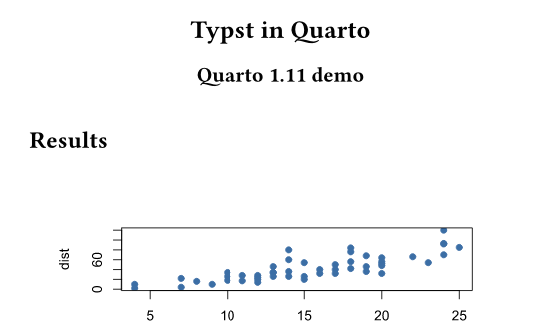
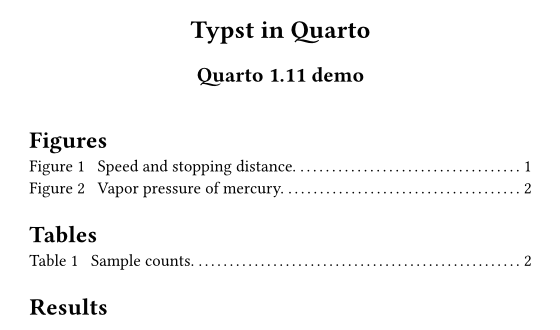
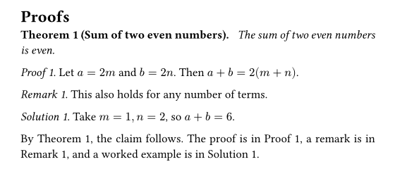

# Quarto 1.11がリリースされました:Typstの新機能を見た目で比べる

quarto

typst

Quarto 1.11のうち、Typst出力の新機能(図表目次・証明ブロックの枠・相互参照)を1.10との出力比較で紹介し、そのほかの変更点も簡単にまとめます。

公開

2026-11-07

更新日

2026-11-07

[English version](../../en/posts/2026-11-07-quarto-1.11/)

2026年11月2日にQuarto 1.11を紹介する[公式ブログ記事](https://opensource.posit.co/blog/2026-11-02_quarto-1-11/)が公開されました。 今回のリリースは、Deno(QuartoがHTTPS通信などに使うランタイム)のセキュリティ更新をいち早く届けるために前倒しで出されたもので、アクセシビリティ、Typst、Julia、共有メタデータの改善も含まれています。 変更点の全体は[リリースノート](https://quarto.org/docs/download/changelog/1.11/)にまとまっています。

この記事では、PDFを作るTypst出力の新機能を中心に、**1.10と1.11で同じ文書を出力して見た目を比べる**形で紹介します。そのほかの変更点は最後に短くまとめます。

## 比較に使った文書

検証用に、図2つ・表1つ・定理と証明ブロックを含む短い文書を用意しました。ソースは[GitHubのリポジトリ](https://github.com/maple60/maple60.github.io/blob/main/posts/2026-11-07-quarto-1.11/_typst-demo/demo.qmd)に置いています。 YAMLヘッダーは次のとおりです。`lof`と`lot`は1.11の新機能で、あとで説明します。

``` yaml
format:
  typst:
    papersize: a5
lof: true
lot: true
crossref:
  lof-title: "Figures"
  lot-title: "Tables"
```

同じファイルを、Quarto 1.10.18と1.11.9でそれぞれ`quarto render`し、Typstでコンパイルした結果が以下の画像です。

## 図表目次(`lof`・`lot`)

1.11では、Typst出力で図の目次(list of figures)と表の目次(list of tables)を出せるようになりました。YAMLに`lof: true`と`lot: true`を書くだけです。 見出しの名前は、文書の言語に合わせて決まります。変えたいときは`crossref`の`lof-title`と`lot-title`で指定します。

左が1.10.18、右が1.11.9の1ページ目の上部です。1.11では、タイトルの下に図と表の一覧が、ページ番号つきで挿入されています。



Quarto 1.10.18



Quarto 1.11.9

## proof・remark・solutionブロックと相互参照

公式ブログによると、1.11ではproof、remark、solutionのブロックが、定理(theorem)と同じ枠組みで描画されるようになりました。 これにより、**ラベルを付けたブロックを相互参照できる**ようになります。IDの接頭辞は、proofが`prf-`、remarkが`rem-`、solutionが`sol-`です。

``` markdown
::: {#prf-sum .proof}
Let $a = 2m$ and $b = 2n$. Then $a + b = 2(m + n)$.
:::

The proof is in @prf-sum.
```

実際に1.11.9で出力した結果が次の画像です。ラベルを付けたブロックには「Proof 1.」のように番号が付き、本文の`@prf-sum`は「Proof 1」に置き換わっています。



Proofs section rendered by Quarto 1.11.9

> **NOTE:**
>
> この検証では、proofなどのブロックが「箱で囲まれる」ような見た目の変化は確認できませんでした。見た目に表れる変化は、番号の付与と相互参照です。 ラベルを付けていない`.proof`は、これまでどおり番号なしの「Proof.」として出力され、1.10.18との違いは見られませんでした。 また、1.10.18の画像は、ラベルを付ける前の同じ文書から出力したものです。ラベル付きブロックを1.10.18で出力した場合との比較は行っていません。1.10での挙動は公式ブログの記述に基づいています。

## Typstのフォント指定

CSSの汎用フォントファミリー名(`serif`、`sans-serif`、`monospace`)が、利用できるフォントに解決されるようになりました。 これまではこれらの名前がそのままTypstに渡され、警告の原因になっていたそうです。見た目に差が出る機能ではないため、画像での比較は省きます。

なお、同梱されているTypstのバージョンは1.10と同じ0.15.1です。

## そのほかの変更点

公式ブログで紹介されている、Typst以外の主な変更点を簡単にまとめます。詳細は公式ブログとリリースノートを参照してください。

- **セキュリティ更新**: 同梱のDenoが2.9.8になり、侵害されたeMudhra・emSignの鍵を含む証明書チェーンを拒否するようになりました。1.10系へのバックポートはなく、1.10.20が最後のパッチリリースです。更新後のDenoはmacOS 12以降が必要です。
- **アクセシビリティ**: 「Skip to main content」リンク、キーボード操作、フォーカスリング、ナビゲーション領域の名前づけなどが改善されました。MermaidとGraphvizの図の代替テキスト(`fig-alt`)も、HTML、Revealjs、Word、Typstで保持されます。
- **Julia**: `execute-dir`や`keep-ipynb: true`に対応し、ハングする問題が修正されました。
- **定義リストの新記法**: `.definition-list`のdivの中に入れ子の箇条書きで書く記法が使えます。Quarto 2で使われる記法とのことです。
- **メタデータの結合**: プロジェクトなどの共有メタデータとドキュメントの同名キーが衝突した場合の扱いが修正されました。`keywords`などを上書き目的で書いている場合は、結果の確認が必要です。
- **Webサイトのメタデータ検証**: `open-graph`と`twitter-card`のスペルミスなどが、無視されずにレンダリングエラーになります。このサイトのように多くのページを持つ場合は、更新後に一度全体をレンダリングして確認すると安心です。
- **ダークテーマなどのカスタムSCSS**: フォーカスリングの変数が`$focus-ring-outer-color`などに変わりました。Bootstrapの`$focus-ring-color`などは使われなくなります。

## 更新方法

更新方法は、[Quarto 1.9の記事](../../posts/2026-03-25-quarto-1.9/index.llms.md)にまとめています。 更新後は`quarto --version`で、バージョンが1.11系になっていることを確認してください。

## 出典と権利について

この記事は、公式ブログ記事とリリースノートを参考に、筆者が自分の言葉で要約したものです。公式の文章や画像は転載していません。掲載している画像は、筆者が自作の文書をQuartoで出力したものです。 Quartoは[Posit](https://posit.co/)の登録商標です。この記事はQuarto公式のものではなく、Positによる承認や関係はありません。
