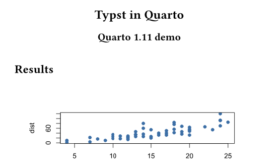
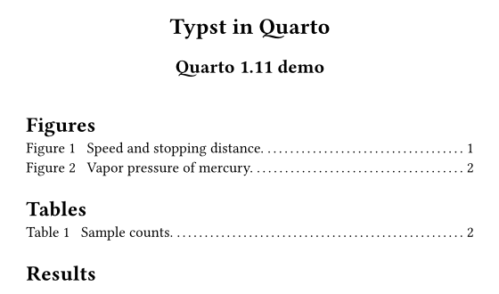
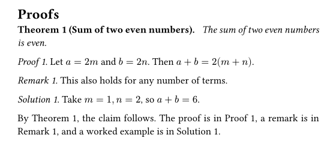

::::: {.content-visible unless-profile="en"}

2026年11月2日にQuarto 1.11を紹介する[公式ブログ記事](https://opensource.posit.co/blog/2026-11-02_quarto-1-11/)が公開されました。
今回のリリースは、Deno(QuartoがHTTPS通信などに使うランタイム)のセキュリティ更新をいち早く届けるために前倒しで出されたもので、アクセシビリティ、Typst、Julia、共有メタデータの改善も含まれています。
変更点の全体は[リリースノート](https://quarto.org/docs/download/changelog/1.11/)にまとまっています。

この記事では、PDFを作るTypst出力の新機能を中心に、**1.10と1.11で同じ文書を出力して見た目を比べる**形で紹介します。そのほかの変更点は最後に短くまとめます。

:::::

::::: {.content-visible when-profile="en"}

On November 2, 2026, the [official announcement post](https://opensource.posit.co/blog/2026-11-02_quarto-1-11/) for Quarto 1.11 was published.
This release came out early to deliver a security update for Deno, the runtime Quarto uses for things like HTTPS requests. It also includes improvements to accessibility, Typst, Julia, and shared metadata.
The full list of changes is in the [release notes](https://quarto.org/docs/download/changelog/1.11/).

This article focuses on the new features for Typst output, which produces PDFs, and **renders the same document with 1.10 and 1.11 so you can compare the results**. The other changes are summarized briefly at the end.

:::::

::::: {.content-visible unless-profile="en"}

## 比較に使った文書

検証用に、図2つ・表1つ・定理と証明ブロックを含む短い文書を用意しました。ソースは[GitHubのリポジトリ](https://github.com/maple60/maple60.github.io/blob/main/posts/2026-11-07-quarto-1.11/_typst-demo/demo.qmd)に置いています。
YAMLヘッダーは次のとおりです。`lof`と`lot`は1.11の新機能で、あとで説明します。

```yaml
format:
  typst:
    papersize: a5
lof: true
lot: true
crossref:
  lof-title: "Figures"
  lot-title: "Tables"
```

同じファイルを、Quarto 1.10.18と1.11.9でそれぞれ`quarto render`し、Typstでコンパイルした結果が以下の画像です。

:::::

::::: {.content-visible when-profile="en"}

## The Document Used for Comparison

I prepared a short test document with two figures, one table, and theorem and proof blocks. The source is in the [GitHub repository](https://github.com/maple60/maple60.github.io/blob/main/posts/2026-11-07-quarto-1.11/_typst-demo/demo.qmd).
The YAML header is shown below. `lof` and `lot` are new in 1.11 and are explained later.

```yaml
format:
  typst:
    papersize: a5
lof: true
lot: true
crossref:
  lof-title: "Figures"
  lot-title: "Tables"
```

The images below are the result of running `quarto render` on the same file with Quarto 1.10.18 and 1.11.9 and compiling it with Typst.

:::::

::::: {.content-visible unless-profile="en"}

## 図表目次(`lof`・`lot`)

1.11では、Typst出力で図の目次(list of figures)と表の目次(list of tables)を出せるようになりました。YAMLに`lof: true`と`lot: true`を書くだけです。
見出しの名前は、文書の言語に合わせて決まります。変えたいときは`crossref`の`lof-title`と`lot-title`で指定します。

左が1.10.18、右が1.11.9の1ページ目の上部です。1.11では、タイトルの下に図と表の一覧が、ページ番号つきで挿入されています。

:::::

::::: {.content-visible when-profile="en"}

## Lists of Figures and Tables (`lof` and `lot`)

Quarto 1.11 can generate a list of figures and a list of tables in Typst output. Just add `lof: true` and `lot: true` to the YAML.
The headings follow the document language. To change them, set `lof-title` and `lot-title` under `crossref`.

On the left is the top of page 1 from 1.10.18, and on the right is the same part from 1.11.9. In 1.11, a list of figures and a list of tables with page numbers is inserted below the title.

:::::

::: {layout-ncol=2}
{fig-alt="Typst PDF output from Quarto 1.10.18. The title is followed directly by the Results heading, with no list of figures or tables."}

{fig-alt="Typst PDF output from Quarto 1.11.9. Below the title are a Figures list with two entries and a Tables list with one entry, each with dotted leaders and page numbers."}
:::

::::: {.content-visible unless-profile="en"}

## proof・remark・solutionブロックと相互参照

公式ブログによると、1.11ではproof、remark、solutionのブロックが、定理(theorem)と同じ枠組みで描画されるようになりました。
これにより、**ラベルを付けたブロックを相互参照できる**ようになります。IDの接頭辞は、proofが`prf-`、remarkが`rem-`、solutionが`sol-`です。

```markdown
::: {#prf-sum .proof}
Let $a = 2m$ and $b = 2n$. Then $a + b = 2(m + n)$.
:::

The proof is in @prf-sum.
```

実際に1.11.9で出力した結果が次の画像です。ラベルを付けたブロックには「Proof 1.」のように番号が付き、本文の`@prf-sum`は「Proof 1」に置き換わっています。

:::::

::::: {.content-visible when-profile="en"}

## Proof, Remark, and Solution Blocks with Cross-References

According to the official announcement, Quarto 1.11 renders proof, remark, and solution blocks with the same machinery as theorems.
As a result, **labeled blocks can be cross-referenced**. The ID prefixes are `prf-` for proofs, `rem-` for remarks, and `sol-` for solutions.

```markdown
::: {#prf-sum .proof}
Let $a = 2m$ and $b = 2n$. Then $a + b = 2(m + n)$.
:::

The proof is in @prf-sum.
```

The image below is the actual output from 1.11.9. Labeled blocks are numbered like "Proof 1.", and `@prf-sum` in the text is replaced with "Proof 1".

:::::

{fig-alt="Typst PDF output from Quarto 1.11.9. A bold Theorem 1 heading is followed by italic labels Proof 1, Remark 1 and Solution 1 in running text. The final sentence refers to Proof 1, Remark 1 and Solution 1 by cross-reference."}

::::: {.content-visible unless-profile="en"}

::: {.callout-note}
## 見た目について

この検証では、proofなどのブロックが「箱で囲まれる」ような見た目の変化は確認できませんでした。見た目に表れる変化は、番号の付与と相互参照です。
ラベルを付けていない`.proof`は、これまでどおり番号なしの「Proof.」として出力され、1.10.18との違いは見られませんでした。
また、1.10.18の画像は、ラベルを付ける前の同じ文書から出力したものです。ラベル付きブロックを1.10.18で出力した場合との比較は行っていません。1.10での挙動は公式ブログの記述に基づいています。
:::

## Typstのフォント指定

CSSの汎用フォントファミリー名(`serif`、`sans-serif`、`monospace`)が、利用できるフォントに解決されるようになりました。
これまではこれらの名前がそのままTypstに渡され、警告の原因になっていたそうです。見た目に差が出る機能ではないため、画像での比較は省きます。

なお、同梱されているTypstのバージョンは1.10と同じ0.15.1です。

:::::

::::: {.content-visible when-profile="en"}

::: {.callout-note}
## About the Visual Differences

In this test, I did not see proof blocks and similar blocks gain a visible box. The visible changes are numbering and cross-references.
An unlabeled `.proof` is still output as an unnumbered "Proof.", and I saw no difference from 1.10.18.
The 1.10.18 image comes from the same document before I added the labels, and I did not render labeled blocks with 1.10.18 for comparison. The description of 1.10 behavior is based on the official announcement.
:::

## Font Names in Typst

CSS generic font family names (`serif`, `sans-serif`, and `monospace`) are now resolved to available fonts.
Previously these names were passed to Typst as they were, which caused warnings. This does not change the appearance, so I skip the image comparison.

The bundled Typst version is 0.15.1, the same as in 1.10.

:::::

::::: {.content-visible unless-profile="en"}

## そのほかの変更点

公式ブログで紹介されている、Typst以外の主な変更点を簡単にまとめます。詳細は公式ブログとリリースノートを参照してください。

- **セキュリティ更新**: 同梱のDenoが2.9.8になり、侵害されたeMudhra・emSignの鍵を含む証明書チェーンを拒否するようになりました。1.10系へのバックポートはなく、1.10.20が最後のパッチリリースです。更新後のDenoはmacOS 12以降が必要です。
- **アクセシビリティ**: 「Skip to main content」リンク、キーボード操作、フォーカスリング、ナビゲーション領域の名前づけなどが改善されました。MermaidとGraphvizの図の代替テキスト(`fig-alt`)も、HTML、Revealjs、Word、Typstで保持されます。
- **Julia**: `execute-dir`や`keep-ipynb: true`に対応し、ハングする問題が修正されました。
- **定義リストの新記法**: `.definition-list`のdivの中に入れ子の箇条書きで書く記法が使えます。Quarto 2で使われる記法とのことです。
- **メタデータの結合**: プロジェクトなどの共有メタデータとドキュメントの同名キーが衝突した場合の扱いが修正されました。`keywords`などを上書き目的で書いている場合は、結果の確認が必要です。
- **Webサイトのメタデータ検証**: `open-graph`と`twitter-card`のスペルミスなどが、無視されずにレンダリングエラーになります。このサイトのように多くのページを持つ場合は、更新後に一度全体をレンダリングして確認すると安心です。
- **ダークテーマなどのカスタムSCSS**: フォーカスリングの変数が`$focus-ring-outer-color`などに変わりました。Bootstrapの`$focus-ring-color`などは使われなくなります。

## 更新方法

更新方法は、[Quarto 1.9の記事](../2026-03-25-quarto-1.9/index.qmd)にまとめています。
更新後は`quarto --version`で、バージョンが1.11系になっていることを確認してください。

## 出典と権利について

この記事は、公式ブログ記事とリリースノートを参考に、筆者が自分の言葉で要約したものです。公式の文章や画像は転載していません。掲載している画像は、筆者が自作の文書をQuartoで出力したものです。
Quartoは[Posit](https://posit.co/)の登録商標です。この記事はQuarto公式のものではなく、Positによる承認や関係はありません。

:::::

::::: {.content-visible when-profile="en"}

## Other Changes

Here is a brief summary of the main non-Typst changes described in the official post. See the post and the release notes for details.

- **Security update**: The bundled Deno is now 2.9.8, which rejects certificate chains containing the compromised eMudhra and emSign keys. It is not backported to 1.10, and 1.10.20 is the final patch release of that series. The updated Deno requires macOS 12 or later.
- **Accessibility**: Improvements include a "Skip to main content" link, keyboard operation, focus rings, and named navigation regions. Alt text (`fig-alt`) for Mermaid and Graphviz diagrams is now preserved in HTML, Revealjs, Word, and Typst.
- **Julia**: `execute-dir` and `keep-ipynb: true` are supported, and hanging issues were fixed.
- **New definition list syntax**: You can write a `.definition-list` div containing nested bullet lists. The post says this is the syntax used by Quarto 2.
- **Metadata merging**: How shared metadata (project-level and similar) is combined with same-named document keys was fixed. If you use keys such as `keywords` to override inherited values, check the result.
- **Stricter website metadata validation**: Misspelled `open-graph` and `twitter-card` options now fail the render instead of being ignored. For a site with many pages like this one, it is worth rendering everything once after updating.
- **Custom SCSS for themes**: Focus ring variables are now `$focus-ring-outer-color` and similar. Bootstrap's `$focus-ring-color` and related variables are no longer used for this.

## How to Update

The update procedure is in my [Quarto 1.9 article](../2026-03-25-quarto-1.9/index.qmd).
After updating, run `quarto --version` to confirm that you are on 1.11.

## Sources and Rights

This article is my own summary based on the official announcement post and the release notes. I did not copy official text or images. The images shown here were produced by rendering my own test document with Quarto.
Quarto is a registered trademark of [Posit](https://posit.co/). This article is not an official Quarto page and is not affiliated with or endorsed by Posit.

:::::
